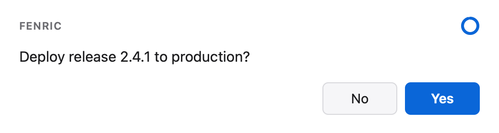
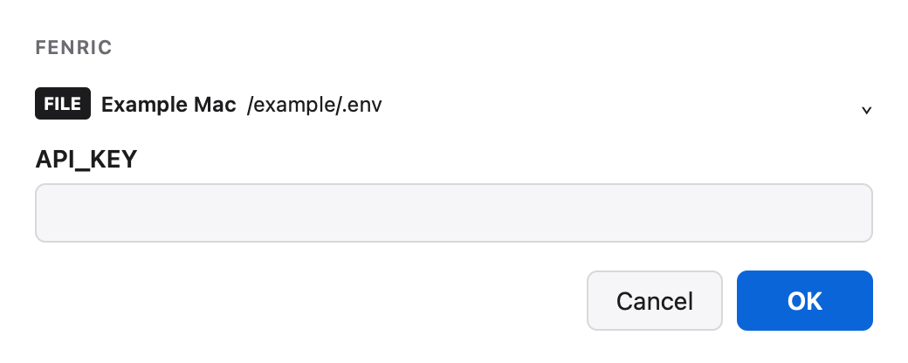

# Fenric

Native dialogs for agents and scripts. A caller sends one spec (a verb and its parameters), the person at the machine answers one window, and the caller reads one result: validated JSON or a plain status.

A terminal prompt is invisible when nobody is watching the terminal, and an agent's chat is the wrong place for passwords or API keys. Fenric is the rung in between: a real window, on the screen now, that blocks the caller for a bounded time and comes back with an answer whose shape the caller can trust. The caller says *what* to ask; Fenric decides how it is shown and contained, with inert custom HTML and operator-authorized ordinary DOM/d3 chart networking in a visibly generated frame.

The name comes from *fenestra*, Latin for window. Fenric was written by Wolf McNally and is released under the MIT license; the d3 library it bundles for charts keeps its own licenses, listed in `fenric/_assets/THIRD_PARTY_NOTICES.md`.

Multiline text fields grow and shrink with wrapped input up to ten visible lines, then scroll. Notifications can show literal copyable text with a dedicated Copy button; copying preserves the exact payload and does not acknowledge the dialog. See [command reference](docs/commands.md).

Review a [paged gallery of screenshots](docs/examples.md#comment-on-screenshots) with retained per-image comments and a final review. The caller supplies local PNGs and stable IDs; `fenric ask --gallery-file manifest.json` returns comments under those IDs.

**Show pictures and let people listen.** Start with the [gallery and audio recipes](docs/media.md): sized PNG screenshots, per-image feedback, and caller-selected WAV playback beside text or a score. Galleries work in released 0.2.0. WAV playback requires 0.3.0 or later; the published 0.2.0 wheel does not include it. Check the receiving runtime before choosing it. A tiny original chime demonstrates the audio path without private recordings or large files. Agents can find the same workflow through `fenric guidance read`.

The separate [request-bound host integration](docs/integration.md) adds a private admitted response channel while preserving standalone use. Its account observations, secret effects and host-reported delivery remain separate; live native adapters and protected coordinator relay require their own qualification.

## Install

Fenric needs Python 3.11 or later. It is developed and tested on macOS; the web view library it uses also supports Linux and Windows, where real GUI behavior remains untested, including charts.

Install it as a command available everywhere with [uv](https://docs.astral.sh/uv/), from the root of the standalone source archive or public checkout (the directory containing `pyproject.toml`):

```bash
uv tool install .
```

or from a built wheel:

```bash
uv tool install fenric-0.3.0-py3-none-any.whl
```

or with [pipx](https://pipx.pypa.io/):

```bash
pipx install .
```

Then `fenric --help` runs from any directory.

Prefer passive skills for [agent-guidance setup](docs/setup.md), leaving `CLAUDE.md` and `AGENTS.md` untouched. The package includes the ordinary `fenric` interaction skill and the separate `fenric-install` installer-use skill, each with its referenced guide; register complete directories only through the selected harness's supported manual procedure. Start with `fenric guidance read --installer` and `fenric lifecycle inventory`, then review a data-only plan with `fenric lifecycle plan --scope global --target claude`. These commands do not install anything or authorize changes. Runtime version, skill content and actual harness loading are separate evidence; native permissions, authentication and networking remain unchanged. Existing shared-instruction setup is a separate explicit operator choice, never the lifecycle default.

## Use

The examples below show command results; the optional `fenric: remote: unavailable: not configured` stderr status is omitted. Fenric still prints that diagnostic when the phone surface has not been configured; it does not change the command's answer or exit status.

New macOS dialogs appear without taking keyboard focus from the active application. Click or tap inside the dialog's content, or select the window and press Tab, before using Space or Enter to respond; opening or refocusing alone never arms those response keys. See [focus and keyboard responses](docs/commands.md#focus-and-deliberate-keyboard-responses). Native focus behavior on other platforms remains unverified, and these controls do not replace native permission or authentication requirements.

Ask a yes-or-no question:

```bash
fenric confirm --message "Deploy release 2.4.1 to production?" --timeout 60
```



<!-- capture {"answer": {"action": "yes", "values": {}}} -->
Pressing **Yes** prints:

```text
true
```

Offer a choice:

```bash
fenric pick --message "Which environment?" --option staging --option production
```


<!-- capture {"answer": {"action": "ok", "values": {"choice": 0}}} -->
Choosing **staging** and pressing OK prints:

```text
"staging"
```

Collect a secret straight into a file, so it never passes through the program that asked:

```bash
fenric secret --field API_KEY --into .env
```



<!-- capture {"answer": {"action": "ok", "values": {"f0": "made-up-key"}}, "file": ".env"} -->
Fenric prints only a status:

```text
ok
```

and `.env`, created readable by its owner only, holds the key:

```text
API_KEY=made-up-key
```

| Exit status | Meaning |
|---|---|
| 0 | The person answered; standard output holds the result. |
| 2 | The person cancelled. |
| 3 | The request was invalid or could not be carried out; standard error says why, without quoting any value. |
| 4 | No window was available, or it timed out untouched; standard output holds `unavailable: <reason>`. |

The verbs are `notify`, `confirm`, `pick`, `ask`, `secret`, `form`, `custom`, `chart` and `html`. From Python:

```python
from fenric import run

result = run({"verb": "pick", "message": "Which?", "options": ["red", "green"]})
if result.status == "ok":
    print(result.value)
```

## Phone surface

After operator setup with `fenric remote setup`, supported dialogs open on desktop and at a temporary HTTPS URL inside the owner's tailnet. First settlement wins. Merely opening the URL leaves the countdown running; editing an answer or activating an enabled dialog control cancels the countdown on both surfaces and leaves a solid subdued ring. Secrets go directly to their file or command sink, with the receiving host and destination visible before submission. Charts use the same dynamic DOM/d3 surface on desktop and configured phone access; they require the separately provisioned chart toolchain.

Fenric reports one early URL or fixed unavailable reason on stderr. Use `--remote-status-file` or the library `remote_status` callback to obtain it programmatically; stdout keeps its single result. The optional announcement command receives the URL after a short grace unless the dialog has already been touched or settled. `--desktop-only` disables remote for one request. No call or spec can enable it. See [remote setup and lifecycle](docs/commands.md#remote-access).

## Documentation

- [Picture galleries and audio previews](docs/media.md): minimal recipes, image sizing, original tiny chime and private-link/result ownership; WAV support is not in released 0.2.0.

- [Agent interaction guide](fenric/_guidance/fenric/guide.md): choosing a surface, approve/decline with comments, live-link handoff and truthful results. `fenric guidance read` prints this installed guide without setup; `fenric guidance read --skill` prints its optional skill entry point. Neither command installs instructions or changes permissions.
- [Python API and tutorial](docs/api.md): public functions, results and isolated example boundaries.
- [Install, update and remove](docs/install.md): existing tool managers, rollback and user-data preservation.
- [Troubleshooting](docs/troubleshooting.md): fixed statuses, GUI/remote/toolchain failures and safe recovery.
- [Native approval walkthrough](docs/native-approvals.md): host transaction, supported mappings and live qualification gaps.

- [Worked examples](docs/examples.md), each with its spec, its command, a picture of the dialog, and the output for each answer.
- [Command reference](docs/commands.md): every verb and option, exit statuses, environment, time limits.
- [Agent setup](docs/setup.md): passive skills by default, optional explicitly reviewed shared instructions, per-harness read paths and native qualification limits.
- [Spec reference](docs/spec.md): every field, every result, and the form component catalog.
- [Security model](docs/security.md): what Fenric trusts, inert HTML, ordinary generated charts and direct credential custody.

The `html` verb embeds unchanged caller-selected HTML and explicitly selected supporting files in a bounded opaque frame, preserving relative navigation. It snapshots an allowlist, not a directory tree; unselected files and outside network access are refused. See [selected HTML](docs/spec.md#html).

Charts need [Bun](https://bun.sh) and a one-time `fenric setup-charts`; see the command reference.

## Project

- [Changelog](CHANGELOG.md)
- [Reporting a security problem](SECURITY.md)
- [Contributing](CONTRIBUTING.md): development setup, tests, the preview harness, and building the browser bundles and the archives.
