# Command reference

`fenric` shows one dialog, waits for the person at the machine to answer it, prints the answer, and exits. Every command below runs as written from this `docs` directory, and every output, file and error shown under one is captured from Fenric itself: the tests rerun each one and compare the displayed output, omitting only the optional `fenric: remote: unavailable: not configured` stderr status. Other diagnostics are retained. The pictures are the dialogs those commands open, rendered from the same commands. The commands that name a file use the [worked examples](examples.md).

## Invocation

A request is a verb and its fields. It can be given as options, as a JSON spec, or both:

```text
fenric <verb> [options]
fenric --spec '<json>'
fenric --spec -
fenric --spec-file path.json
```

With no arguments, `fenric` prints the same help as `fenric --help` to standard output and exits with status 0, without opening a dialog or starting a server. Invalid arguments still exit with status 3.

`--spec -` reads the spec from standard input. `--spec` and `--spec-file` may also follow a verb; the spec then need not name the verb, and may not name a different one. A verb option sets the spec field of the same name and overrides it. The fields themselves are in the [spec reference](spec.md).

```bash
fenric --spec '{"verb": "confirm", "message": "Proceed?"}'
```

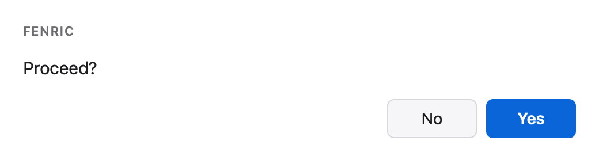

<!-- capture {"answer": {"action": "yes", "values": {}}} -->
Pressing **Yes** prints:

```text
true
```

```bash
fenric confirm --spec-file examples/confirm.json --message "Deploy release 2.4.2 instead?"
```

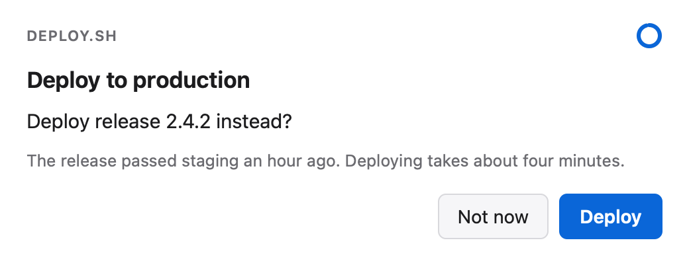

<!-- capture {"answer": {"action": "no", "values": {}}} -->
The option replaced the spec's message. Pressing **Not now** prints:

```text
false
```

```bash
fenric pick --spec-file examples/confirm.json
```

<!-- capture {"exit": 3} -->
A spec that names a different verb than the command is refused before anything is shown:

```text
fenric: error: the spec names a different verb than the command
```

```bash
fenric --help
```

<!-- capture {} -->
It prints the command's help:

```text
usage: fenric [-h] [--spec SPEC] [--spec-file SPEC_FILE] [--app APP]
              [--timeout TIMEOUT] [--fallback-file FALLBACK_FILE]
              [--desktop-only] [--remote-status-file REMOTE_STATUS_FILE]
              [--version]
              <verb> ...

Put a native dialog in front of the person at the machine and return what they
answered as validated JSON or a plain status.

positional arguments:
  <verb>
    notify              Show a message. Prints ok.
    confirm             Ask yes or no. Prints true or false.
    pick                Choose one or several from a list. Prints the choice.
    ask                 Pose one or more questions. Prints an object keyed by
                        question id. For several decisions, use --spec-file
                        with an ask spec containing presentation: "wizard".
                        Omitting presentation shows all questions together;
                        there is no wizard verb.
    secret              Collect credentials into a store command or a file.
                        Prints ok.
    form                Show a form from the component catalog. Prints an
                        object keyed by input id.
    custom              Show sanitized HTML in an inert frame. Prints ok.
    chart               Show a d3 chart written in TypeScript. Prints ok.
    html                Show unchanged explicitly selected HTML and supporting
                        files. Prints ok.
    interact            Answer a host-admitted request on an inherited private
                        channel.
    setup-charts        Provision the chart toolchain into the per-user cache.
                        Prints ok.
    remote              Configure the tailnet surface.
    guidance            Read agent usage guidance or review instruction setup.
    lifecycle           Inspect installation and propose a read-only skill
                        lifecycle plan.

options:
  -h, --help            show this help message and exit
  --spec SPEC           the spec as JSON, or - to read stdin
  --spec-file SPEC_FILE
                        a file holding the spec as JSON
  --app APP             name of the program that is asking
  --timeout TIMEOUT     seconds before an untouched dialog expires
  --fallback-file FALLBACK_FILE
                        where to write the request as plain text when no
                        window is available
  --desktop-only
  --remote-status-file REMOTE_STATUS_FILE
  --version             show program's version number and exit

Exit status: 0 answered, 2 cancelled, 3 invalid request, 4 unavailable. Agent
usage guide: fenric guidance read (read-only; no setup).
```

```bash
fenric --version
```

<!-- capture {} -->
It prints the version:

```text
fenric 0.2.0
```

## Focus and deliberate keyboard responses

On macOS, a new Fenric dialog is shown without activating the application or taking the current application's keyboard focus. It is not always on top. This covers notifications as well as questions and approval presentations; it changes neither authentication nor native approval authority. Native Linux/Windows focus behavior remains unverified.

New pages do not automatically focus an answer field, default button or wizard heading. Click or tap inside the dialog's content, or select the window and press Tab (Shift+Tab enters from the end), to engage keyboard responses. Selecting the title bar alone does not engage them. Space and Enter cannot answer or acknowledge an unengaged page, including after it loses focus; focus alone is not engagement. A key held before engagement and repeated activation keys cannot become a response. Ordinary text editing and keyboard navigation work after engagement. Escape and explicit Cancel remain cancellation, never consent. Engagement/navigation alone does not cancel the countdown or extend a deadline.

Each concurrent dialog keeps its own engagement and one-settlement state. This change applies to newly started processes; an already open dialog keeps its existing behavior and must not be dismissed or restarted merely to update it.

## Options for standalone invocation

These are accepted on any dialog request: before a verb, after one, or with no verb at all. `setup-charts` shows no dialog and takes none of them.

| Option | Meaning |
|---|---|
| `--spec` | The spec as JSON, or `-` to read it from standard input. |
| `--spec-file` | A file holding the spec as JSON. |
| `--app` | The name of the program that is asking. It becomes the window title and the small label above the dialog. Default `Fenric`. |
| `--timeout` | Seconds before an untouched dialog expires, greater than 0 and at most 3600. The countdown ring becomes solid and subdued after an answer edit or enabled control activation; its label is “Timeout canceled”. The hard deadline remains. |
| `--fallback-file` | Where to write the request as plain text when no window is available, so the caller can route it elsewhere. |
| `--desktop-only` | Disable the machine-configured remote surface for this request. |
| `--remote-status-file` | Write the early remote status object as JSON; it never holds an answer. |

`--help` prints help for the command or for one verb; `--version` prints `fenric` and its version.

```bash
fenric confirm --app backup.sh --message "Rotate the keys now?" --timeout 30 --fallback-file pending.txt
```

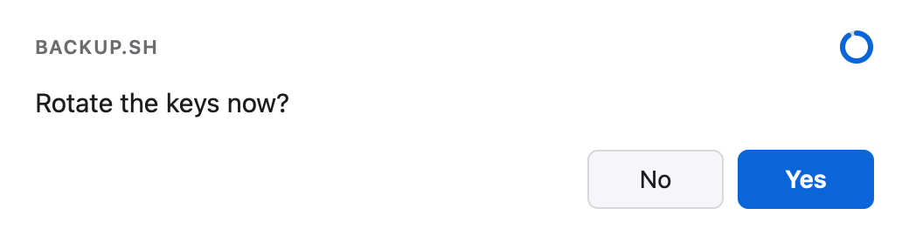

<!-- capture {"answer": "expire", "exit": 4, "file": "pending.txt"} -->
Left untouched until the ring drains, it prints the reason and writes the request to the fallback file, so the caller can ask some other way:

```text
unavailable: timed out
```

`pending.txt`:

```text
backup.sh asks (confirm)
Rotate the keys now?
Answer: Yes / No
```

```bash
fenric confirm --message "Rotate the keys now?" --timeout 9000
```

<!-- capture {"exit": 3} -->
A timeout outside the allowed range is refused with the range:

```text
fenric: error: timeout must be greater than 0 and at most 3600 seconds
```

## Verbs

Every verb takes `--title`, a heading inside the dialog.

### notify

Shows a message. Prints `ok`.

| Option | Meaning |
|---|---|
| `--title` | A heading inside the dialog. |
| `--message` | The message. Required. |
| `--detail` | Secondary text. |
| `--copy-text` | Exact nonblank UTF-8 text for the literal copy view. |
| `--copy-file` | Read the literal payload from a UTF-8 file without newline conversion; excludes `--copy-text` or a spec copy payload. |

For literal code or other copyable text, add `--copy-file payload.txt` (UTF-8, decoded without changing newlines) or `--copy-text` with the exact payload. The equivalent spec field is `copy_text`. The dedicated plain-text view applies no Markdown, syntax highlighting, quote substitution or added fences; Copy text writes only the supplied payload, including its whitespace and any literal fences already present. This is for ordinary caller-prepared text, not secrets. Invalid UTF-8 and blank payloads are refused. `--copy-file` cannot be combined with `--copy-text` or a spec copy payload; `--copy-text` follows the ordinary flag-over-spec precedence.

Copying is deliberate interaction and cancels an untouched countdown, but does not acknowledge or settle the dialog. “Copied” appears only after the browser reports success; denial or unavailable clipboard access leaves the text selectable with manual-copy guidance. The protected HTTPS phone view calls the clipboard API directly from the tap, as Safari requires. Clipboard access still depends on the browser; no permission setting or native bridge is added. Browser tests verify exact write arguments and feedback, while actual iPhone OS paste remains a separate manual check. The acknowledgment still returns only `ok`, not evidence of clipboard delivery or action consent.

```bash
fenric notify --title "Nightly build" --message "The nightly build finished." --detail "All 212 tests passed."
```

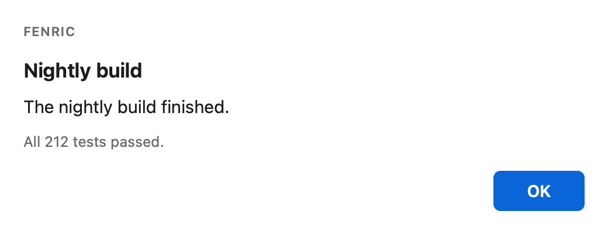

<!-- capture {"answer": {"action": "ok", "values": {}}} -->
Pressing OK prints:

```text
ok
```

```bash
fenric notify --detail "All 212 tests passed."
```

<!-- capture {"exit": 3} -->
A required field left out is named, and nothing is shown:

```text
fenric: error: message is required
```

### confirm

Asks yes or no. Prints `true` or `false`; either is an answer and exits 0.

| Option | Meaning |
|---|---|
| `--title` | A heading inside the dialog. |
| `--message` | The question. Required. |
| `--detail` | Secondary text. |
| `--yes-label` | The label of the yes button. Default `Yes`. |
| `--no-label` | The label of the no button. Default `No`. |

```bash
fenric confirm --message "Delete the old snapshots?" --yes-label Delete --no-label Keep
```

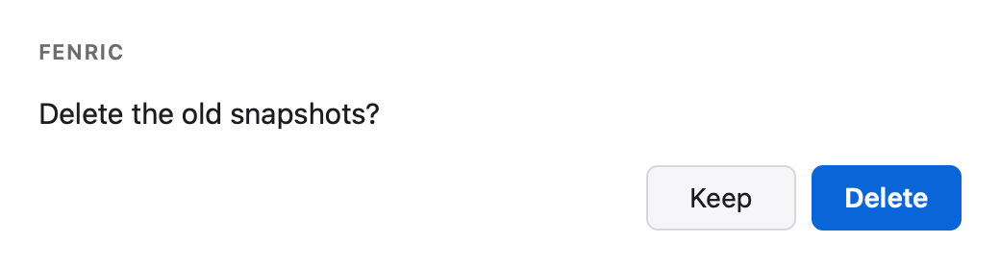

<!-- capture {"answer": {"action": "no", "values": {}}} -->
Pressing **Keep** prints:

```text
false
```

<!-- capture {"answer": "cancel", "exit": 2} -->
Pressing Escape, or closing the window, is a cancel:

```text
cancelled
```

### pick

Chooses one option, or several. Prints the chosen option as a JSON string, or with `--multiple` a JSON list in the options' order.

| Option | Meaning |
|---|---|
| `--title` | A heading inside the dialog. |
| `--message` | The prompt. Required. |
| `--option` | One option; repeat for each. From the command line an option's label is also its id; a spec can give them separately. |
| `--multiple` | Allow several choices. |

```bash
fenric pick --message "Which environment?" --option staging --option production
```

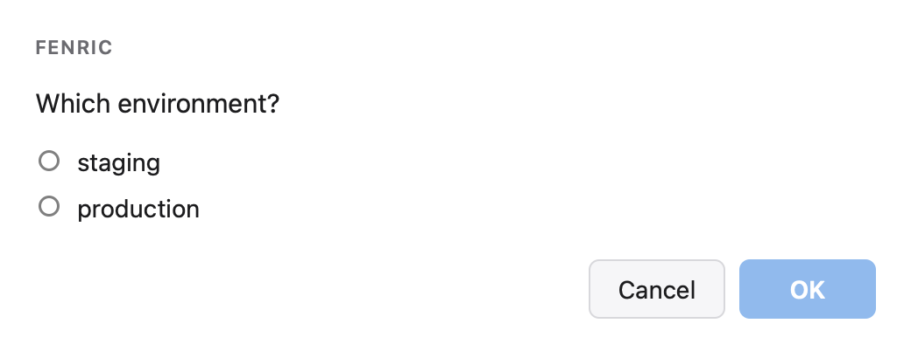

<!-- capture {"answer": {"action": "ok", "values": {"choice": 1}}} -->
Choosing **production** and pressing OK prints:

```text
"production"
```

```bash
fenric pick --message "Which checks should run?" --option lint --option tests --option docs --multiple
```

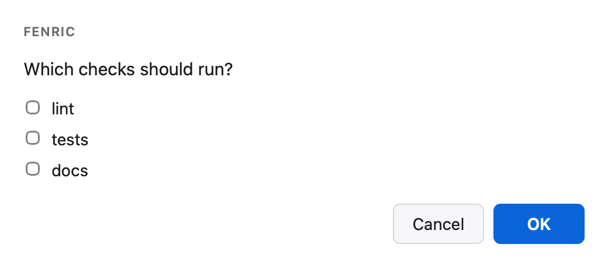

<!-- capture {"answer": {"action": "ok", "values": {"choice": [2, 0]}}} -->
Ticking **docs** and then **lint** prints them in the options' order:

```text
["lint","docs"]
```

### ask

Poses one or more questions. Prints a JSON object keyed by question id. From the command line every question is free text and the ids are `q1`, `q2` and so on; a spec can ask choice and multiple-choice questions, with "Something else" ([spec reference](spec.md#ask), [worked example](examples.md#ask-several-questions)).

For several substantial decisions, prefer an `ask` spec with `"presentation":"wizard"` and stable question IDs, supplied through `fenric --spec-file questions.json` ([wizard example](examples.md#ask-one-question-at-a-time)). Back/Next and final review retain answers until submission. Wizard selection is explicit: repeated `--question` and omitted `presentation` show all questions together. There is no `wizard` verb or `--wizard` option; catalog `form` cards do not support this field.

| Option | Meaning |
|---|---|
| `--title` | A heading inside the dialog. |
| `--message` | Text above the questions. |
| `--question` | One free-text question; repeat for each. |
| `--gallery-file` | Local PNG manifest, producing a paged image-comment wizard; mutually exclusive with other question specs. |

Multiline text answers grow and shrink to fit their entered text and current wrapping width, from one through ten visible text lines, then scroll inside the field. This also applies to multiline form fields, wizard answers and gallery comments on native and configured phone views. Manual vertical dragging is replaced by automatic sizing; single-line inputs and secret fields are unchanged. Newlines remain answer text, not submission keys.

```bash
fenric ask --message "Before I start" --question "What should the branch be called?" --question "Anything I should avoid?"
```

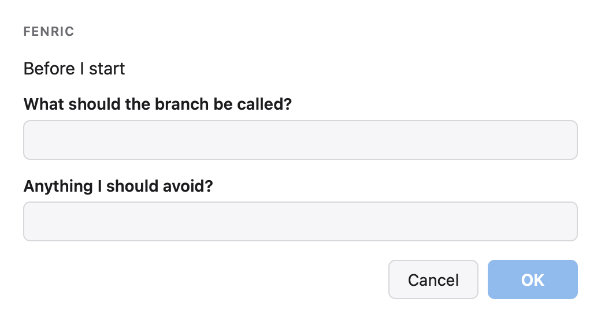

<!-- capture {"answer": {"action": "ok", "values": {"q0": "fix-login-timeout", "q1": "Leave the session code alone."}}} -->
Typing a branch name and a note and pressing OK prints:

```text
{"q1":"fix-login-timeout","q2":"Leave the session code alone."}
```

For screenshot comments, use `--gallery-file` with the [manifest contract](spec.md#images-and-screenshot-galleries) and [worked example](examples.md#comment-on-screenshots). Image filenames resolve relative to the manifest. Back/Next and review/Edit preserve comments while the page is open, and results retain the manifest's image IDs. The example sets `timeout` to 3600; without it the ordinary hard limit is five minutes even after interaction. Image inspection cancels the visible countdown, not the hard deadline.

### secret

Collects one or more credentials in masked fields and hands them to a destination. Prints only `ok`: no value ever reaches Fenric's output, error messages or exit status. Exactly one of `--store` and `--into` is required.

| Option | Meaning |
|---|---|
| `--title` | A heading inside the dialog. |
| `--message` | Text above the fields. |
| `--field` | `NAME` or `NAME=LABEL`; repeat for each. A name may hold letters, digits, dot, underscore and hyphen. |
| `--store-label` | Optional description for a store command; quoted in generated-content colour. Requires `--store`. |
| `--store` | A command run once for each field the person filled in, with the value on its standard input. `{name}` in the command is replaced by the field's name. No shell runs it, and its output is discarded. |
| `--into` | A file each filled field is written into, under its name: a dotenv or direnv file, a flat JSON object of strings, or a file holding one value. |

```bash
fenric secret --field OPENAI_API_KEY --into .env
```

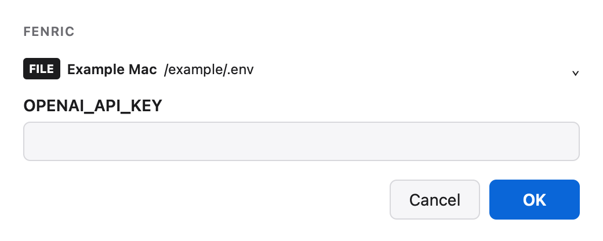

<!-- capture {"answer": {"action": "ok", "values": {"f0": "sk-made-up-0000"}}, "setup": {".env": "# Local settings\nexport API_URL=https://api.example.test\n"}, "file": ".env"} -->
With a `.env` that already holds a comment and an exported setting, typing a key and pressing OK prints only a status:

```text
ok
```

and the key is added in the file's own style, everything else left as it was:

```text
# Local settings
export API_URL=https://api.example.test
export OPENAI_API_KEY=sk-made-up-0000
```

A store command can be any program that reads the value from its standard input, such as `pass insert --multiline secrets/{name}` or a cloud CLI's secret command. Here `tee` stands in for one, so the result can be shown:

```bash
fenric secret --field 'DEPLOY_TOKEN=Deploy token' --store 'tee secrets/{name}'
```

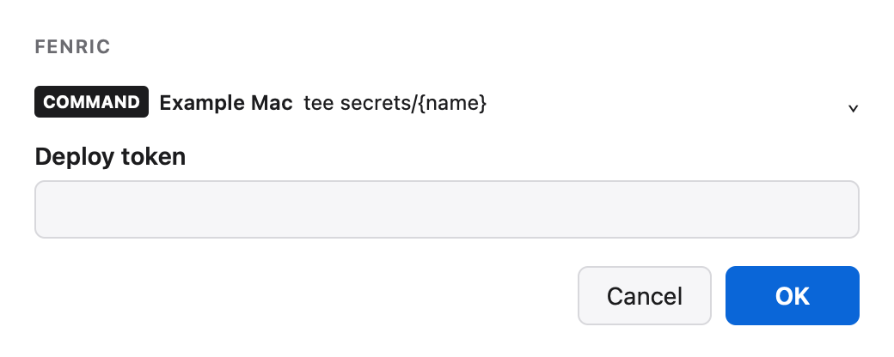

<!-- capture {"answer": {"action": "ok", "values": {"f0": "made-up-token"}}, "setup": {"secrets/.keep": ""}, "file": "secrets/DEPLOY_TOKEN"} -->
The store's own output is discarded, so Fenric prints only:

```text
ok
```

and the store received the value on its standard input:

```text
made-up-token
```

```bash
fenric secret --field OPENAI_API_KEY
```

<!-- capture {"exit": 3} -->
A secret with nowhere to go is refused before any window opens:

```text
fenric: error: store or into is required: the secret verb needs a store command or a file
```

```bash
fenric secret --field TOKEN --into credentials.json
```

<!-- capture {"exit": 3, "setup": {"credentials.json": "{\"installed\": {\"client_id\": \"made-up\"}}\n"}} -->
So is a file Fenric cannot update exactly, such as a nested JSON file, which is left untouched:

```text
fenric: error: the target file holds JSON that is not a flat object of strings
```

The formats, and how each is updated, are in the [spec reference](spec.md#the-file-target).

### form

Shows a form built from the component catalog. Prints a JSON object keyed by input id. A form is given as a spec; the only option of its own is the title.

| Option | Meaning |
|---|---|
| `--title` | A heading inside the dialog. |

```bash
fenric form --spec-file examples/form.json --title "Release 2.5 notes"
```

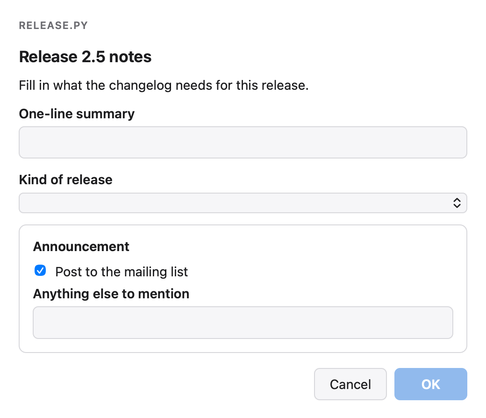

<!-- capture {"answer": {"action": "ok", "values": {"c0": "Plugins can add verbs", "c1": 2, "c2": false, "c3": "Breaks the 1.x plugin API."}}} -->
Filling it in and pressing OK prints:

```text
{"summary":"Plugins can add verbs","kind":"major","announce":false,"notes":"Breaks the 1.x plugin API."}
```

### custom

Shows HTML as static content: sanitized, in a frame that runs no script, marked as generated content. Prints `ok`.

| Option | Meaning |
|---|---|
| `--title` | A heading inside the dialog. |
| `--html` | The HTML. |
| `--html-file` | A file holding the HTML. |
| `--height` | The frame's height in pixels, 100 to 2000. Default 420. |

```bash
fenric custom --title "Summary" --height 160 --html "<p>The <b>migration</b> finished in 41 seconds.</p><ul><li>3 tables changed</li><li>0 rows lost</li></ul>"
```

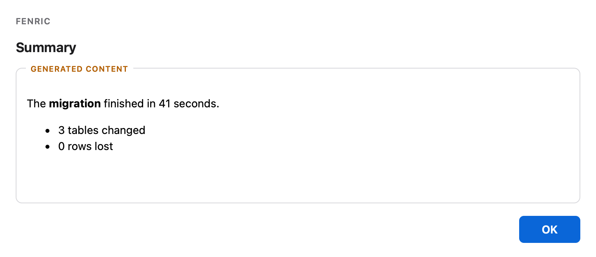

<!-- capture {"answer": {"action": "ok", "values": {}}} -->
Pressing OK prints:

```text
ok
```

### html

| Option | Meaning |
|---|---|
| `--title` | Heading outside the embedded content. |
| `--root` | Selected directory; relative to the caller's working directory. |
| `--entry` | Selected HTML entry path relative to the root. |
| `--file` | One selected support or entry file; repeat for each exact relative path. |
| `--height` | Requested frame height, 100 to 2000 pixels; default 420. Guides the initial desktop fit; the frame then follows the resized window. |

Embed unchanged selected HTML with relative navigation and presentation scripts, without compiling a chart or weakening `custom` sanitization. A JSON spec's `files` array is convenient for larger selections. See [the selection and containment contract](spec.md#html). Choose only presentation files; unavailable links remain refused. Embedded interactions never approve anything or extend the deadline.

On desktop, selected HTML windows fit once within the usable display area and can then be resized. The requested height guides that initial fit; the content frame grows or shrinks with the chosen window, scrolling longer documents. Trusted controls remain outside the embedded content, with outer scrolling if needed at a small size. Resizing does not engage an answer or extend the deadline. Other dialog types retain their content-sized windows; configured phone presentation keeps its existing frame-height behavior.

```bash
fenric html --title "Selected report" --root report --entry index.html --file index.html --file style.css --height 240
```

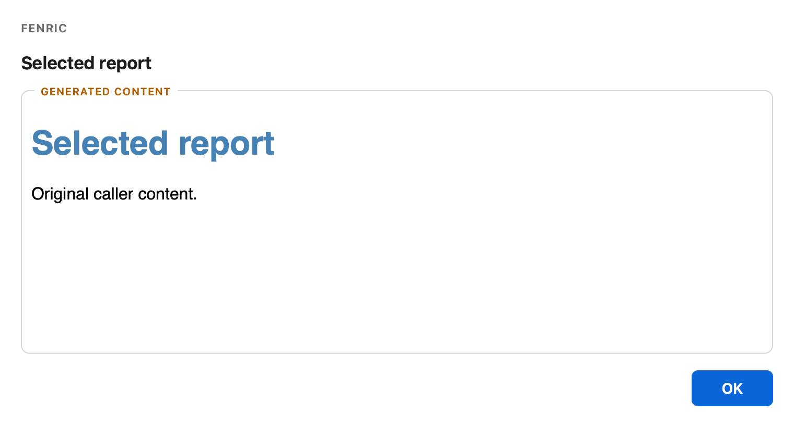

<!-- capture {"answer":{"action":"ok","values":{}},"setup":{"report/index.html":"<!doctype html><html><head><link rel=\"stylesheet\" href=\"style.css\"></head><body><h1>Selected report</h1><p>Original caller content.</p></body></html>","report/style.css":"body { font-family: sans-serif; } h1 { color: steelblue; }"}} -->
Pressing OK acknowledges the view and prints:

```text
ok
```

### chart

Shows a chart drawn by d3 code written in TypeScript. The code is type-checked and compiled before the window opens, and runs against the real DOM with ordinary browser networking and no native filesystem/Python API. Prints `ok`. Charts use the same ordinary DOM/d3 on native and configured remote surfaces, and need `fenric setup-charts` once.

| Option | Meaning |
|---|---|
| `--title` | A heading inside the dialog. |
| `--code-file` | A TypeScript file. It draws into the global `root` with the global `d3`. |
| `--data-file` | A JSON file, passed to the code as the global `data`. |
| `--height` | The frame's height in pixels, 100 to 2000. Default 420. |

```bash
fenric chart --code-file examples/chart.ts --data-file examples/orders.json --title "Orders by month" --height 340
```


<!-- capture {"answer": {"action": "ok", "values": {}}} -->
Pressing OK prints:

```text
ok
```

### interact

This separate host-integrated mode consumes an already admitted private inherited Unix socket. It accepts no ordinary spec, fallback or remote-status-file options, even when placed before the subcommand. A caller flag grants no native authority. Answers, effect status and host-reported delivery remain on the private channel; no answer or capability is printed to stdout. See the [integration contract and qualification limits](integration.md).

| Option | Meaning |
|---|---|
| `--channel-fd` | Required inherited connected Unix stream descriptor, at least 3. The requesting host owns admission and exact request binding. |

```bash
fenric interact --help
```

<!-- capture {} -->
The command describes its private entry point without opening a dialog:

```text
usage: fenric interact [-h] --channel-fd CHANNEL_FD

Use an already admitted private Unix socket; this flag grants no native
authority.

options:
  -h, --help            show this help message and exit
  --channel-fd CHANNEL_FD
```

### guidance

Read the installed [agent usage guide](../fenric/_guidance/fenric/guide.md), or review and verify shared instruction setup. This verb opens no dialog and accepts no ordinary spec, timeout or remote options, even before the verb. `read` is independent of home-directory setup. For instruction management use `preview`, explicit `apply` and read-only `check`; see [standard setup](setup.md). Guidance is separate from native adapter readiness, which remains unverified. No hooks, settings, permissions or read-path creation is performed.

### guidance read

Print the canonical installed usage guide as Markdown; `--skill` prints its short optional skill entry point instead. Both exit 0 on success and need no GUI, remote surface or HOME. Missing packaged resources are errors, not an empty successful guide. No instruction installation or network access occurs.

| Option | Meaning |
|---|---|
| `--skill` | Print the packaged skill entry point instead of the full guide. |
| `--installer` | Select the passive installer-use guide or skill instead of ordinary interaction guidance. |

### guidance preview

| Option | Meaning |
|---|---|
| `--home` | Existing home whose two conventional instruction read paths are inspected. Default is HOME; no account-database fallback. |
| `--plan` | Required new owner-only JSON plan file containing resolved paths, hashes and exact guidance diff. |
| `--remove` | Preview removal of intact owned guidance instead of installation/update. |

### guidance apply

| Option | Meaning |
|---|---|
| `--home` | Same home used to produce the reviewed plan. |
| `--plan` | Required exact reviewed plan; changed content, identities or template refuse. |
| `--backup-dir` | Required new private directory for original bytes, target manifest and operation outcome. |

### guidance check

| Option | Meaning |
|---|---|
| `--home` | Existing home whose expected read paths and guidance are checked separately. |

The three commands print structured metadata/diffs, never a user answer. Check exits 4 for missing/broken/conflicting/unmanaged or outdated guidance; apply/preview may operate on one existing path while reporting the other missing. Exit 3 reports an invalid or unavailable operation. Exit 0 never proves native approval authority or live harness loading. An apply failure preserves precise backup/outcome evidence; do not blindly retry it.

### lifecycle

Inspect installation evidence and propose a deterministic skill lifecycle plan. This management command opens no dialog, executes no target binary, imports no target package and changes no files, configuration, constitutional instructions or runtime selection. Common dialog/spec/remote options are invalid. The passive installer-use skill is available with `fenric guidance read --installer`; installing the package does not register either skill.

### lifecycle inventory

| Option | Meaning |
|---|---|
| `--home` | Explicit existing home; defaults to HOME. Only conventional named skill candidates are inspected. |
| `--project` | Optional explicit existing project; inventory both global and project candidates without ancestor search. |
| `--executable` | Selected executable to inspect without running it; otherwise resolve PATH once. |

The inventory reports selected symlink/file identity, bounded neighboring environment/distribution metadata, recognized untrusted manager records, artifact hash evidence where available, skill member manifests, ownership and scope conflicts. Missing runtime or undeclared skill version stays missing/unknown/null; runtime metadata never supplies a skill version. Conventional `.claude/skills`, `.codex/skills` and `.agents/skills` candidates are not evidence of configured precedence. Custom scope, actual live process version and harness-loaded skill state remain unknown. Without `--project`, project shadowing is unobserved.

### lifecycle plan

| Option | Meaning |
|---|---|
| `--home` | Explicit existing home; defaults to HOME. |
| `--project` | Explicit existing project; required for project scope. |
| `--executable` | Selected executable to inspect, never execute. |
| `--scope` | Required `global` or `project`; skills are the default guidance strategy. |
| `--target` | Repeat `claude`, `codex` or `agents` to select conventional skill roots; default `claude` and `codex`. |
| `--remove` | Propose removal of intact owned skills; removes nothing. |

The data-only plan proposes add/update/remove/no-op/blocked skill operations and records expected identities, parent identity, desired bundle manifests and a digest. There is no apply endpoint, runtime installer or command executor. An identical unowned bundle is a no-op and remains unowned; update/removal requires exact intact local receipt evidence. Modified, extra, unsafe, unreadable or conflicting targets block. Missing parent directories block adds. The receipt `.fenric-skill.json` is excluded from the bundle digest, parsed strictly and bound to name, scope-relative location, declared version and exact manifest digest; it grants no permission. Distinct roots in one scope are independent targets; global/project overlap requires review. Same-identity aliases may remain no-ops, but mutating proposals for duplicate aliases or a symlinked skill target block.

Each JSON result has a `complete` boolean; a plan with incomplete observations never reports `dry-run` success. Missing artifact claims are reported as `unclaimed`, not a hash mismatch. Manager recognition reads only bounded `uv-receipt.toml`, `pipx_metadata.json`, or the selected stage's `STAGING-RECEIPT.json` with matching `cli` and `version`; these records remain untrusted local evidence. Runtime metadata links outside the selected environment refuse. Artifact comparison uses only a local wheel in the selected stage, never a directory scan. Both given and resolved input paths are retained in the plan identity, so alternate spellings can intentionally produce different plan digests.

Limits are included in each inventory: 1 MiB per member, 4 MiB per tree, 128 entries, depth 8, 256 siblings, 4096 shebang bytes, 16 MiB local wheel and 16 symlink hops. Reads use bounded descriptors; member links, hardlinks and foreign ownership refuse rather than expose an arbitrary filesystem. Versions, unknown states and sorted-key JSON digests are documented in the [installer guide](../fenric/_guidance/fenric-install/guide.md). Inventory exit 0 means observations completed, including reported drift/conflict; exit 4 means incomplete observation. Plan exit 4 also means blocked operations; exit 3 is invalid input/unavailable operation. Neither status measures live harness discovery, GUI behavior or native permission readiness. Reobserve changed inputs before separately authorized manual work.

### setup-charts

Provisions what the `chart` verb compiles with — TypeScript and the d3 type definitions, at the versions locked in the package — into a per-user cache, once. It needs [Bun](https://bun.sh) on `PATH` and network access, and prints `ok`. No other verb needs it.

```bash
fenric setup-charts
```

Without it, a chart is refused before any window opens, with ``fenric: error: the chart toolchain is not provisioned; run `fenric setup-charts` ``.

## Output and exit status

| Exit | Standard output | Meaning |
|---|---|---|
| 0 | One line of JSON for `confirm`, `pick`, `ask` and `form`; `ok` for the others | The person answered. |
| 2 | `cancelled` | The person closed the dialog, pressed Escape, or chose Cancel. |
| 3 | nothing | The request was invalid or could not be carried out. Standard error holds one line, `fenric: error: …`, which names the field at fault and never quotes a value. |
| 4 | `unavailable: <reason>` | No window was available. |

The reasons for exit 4 are `headless`, `timed out` and `render failure`. Exit 4 is the caller's cue to ask some other way; with `--fallback-file`, the request is also written there as plain text.

A request is checked before Fenric looks for a window: an invalid spec, a secret with no destination, a file target that cannot be updated, or a chart that does not compile is exit 3 even when no window could have opened.

```bash
fenric --spec '{"verb": "notify", "message": "Hi", "colour": "red"}'
```

<!-- capture {"exit": 3} -->
An unknown field is refused without quoting it or its value:

```text
fenric: error: spec has an unknown field
```

```bash
fenric confirm --message "Proceed?" --no-such-option
```

<!-- capture {"exit": 3} -->
A usage error prints one fixed line rather than echoing the arguments:

```text
fenric: error: invalid invocation; run `fenric --help`
```

## Environment

| Variable | Effect |
|---|---|
| `FENRIC_HEADLESS` | Set to `1`, Fenric checks the request and then reports `unavailable: headless` without loading a web view. Useful in tests and on machines with no display. |
| `FENRIC_CACHE_DIR` | Where `setup-charts` puts the chart toolchain, and where `chart` looks for it. Default `~/Library/Caches/fenric` on macOS. |

```bash
FENRIC_HEADLESS=1 fenric notify --message "Checked, not shown."
```

<!-- capture {"exit": 4} -->
The request is checked, and no window is opened:

```text
unavailable: headless
fenric: remote: unavailable: headless
```

## Time limits

Every window has a hard time limit, enforced from outside the page. Without `--timeout`, it is 300 seconds. With `--timeout N`, an untouched dialog expires at N seconds (and the window is closed from outside at N + 12 seconds if the page never reports); once the person edits an answer or activates an enabled dialog control, the dialog waits for them until 300 seconds or N + 12 seconds, whichever is later. With the largest timeout, 3600, a window can stay open for 3612 seconds.

## The library

See the complete [public Python API and tutorial](api.md), including gallery loading, cancellation and integrated result boundaries.

The same engine is importable. `run` takes a spec as a mapping and returns a result with `status` (`ok`, `cancelled`, `error` or `unavailable`), `exit_code`, `value` and `detail`. It does not raise for an invalid spec.

```python
from fenric import run

result = run({"verb": "pick", "message": "Which?", "options": ["red", "green"]})
if result.status == "ok":
    print(result.value)
```

Choosing **green** prints `green`. With an invalid spec, `result.status` is `error`, `result.exit_code` is `3`, and `result.detail` is the message the command would print after `fenric: error:`.

## Remote access

### remote

The operator enables a temporary phone surface once with `fenric remote setup`. This requires Tailscale on the receiving computer and phone, signed into the same owner account, and tailnet HTTPS enabled. Certificate hostnames enter the public Certificate Transparency ledger. Setup verifies HTTPS using an owned temporary Serve probe before saving enabled configuration; it opens no public route. No spec or ordinary request can enable remote. `fenric remote status` reports configuration and `fenric remote off` disables it.

```bash
fenric remote setup
```

Setup accepts `--tailscale` (executable, resolved and recorded), `--port-start` and `--port-end` (inclusive range, default 8443–8450), `--grace` (announcement grace, default 3 seconds) and `--announce` (command split without a shell). Configuration is owner-only `~/.config/fenric/remote.json`, overridable with `FENRIC_CONFIG_DIR`. The announcement command receives only the URL on stdin; output is discarded. It runs after grace only before actual interaction or settlement. Fenric chooses no notification tool.

Enabled dialogs open on desktop and at a temporary tailnet-only HTTPS URL, including dynamic charts. One early stderr line is `fenric: remote: <HTTPS URL>` or `fenric: remote: unavailable: <reason>`. The optional JSON status file and library callback contain `status`, `url` and `reason`. Reasons are `not configured`, `disabled`, `configuration error`, `headless`, `tailscale unavailable`, `tailnet unavailable`, `HTTPS unavailable`, `owner unavailable`, `ports unavailable`, `setup failed` and `session ended`. Standard output remains the one result line. Remote failure never fails the desktop dialog. `--desktop-only`, `FENRIC_DESKTOP_ONLY=1` and the library override may only disable remote.

Both surfaces share one clock and first settlement. Visiting, leaving, backgrounding or reloading leaves the ring running. Blank-space taps, scrolling, focus alone, modifier/navigation keys and interrupted gestures do not cancel it. Activating an enabled dialog control (including an answer field or disclosure) or editing an answer cancels the countdown on both surfaces and leaves a solid subdued ring labeled “Timeout canceled”, also on later visits. Chart frame interaction retains its touch/cancel behavior and shows the same subdued ring. The server hard deadline still applies; explicit Cancel, Escape and native close still cancel the dialog itself. SIGINT/SIGTERM cancel the caller's pending dialog. Each session owns its listener, port and foreground Serve child; parent death stops its child too, without resetting other mappings. Following settlement a bounded 0.5-second terminal acknowledgement window permits retries to receive the recorded outcome before the address disappears. Responses never carry answers. Invalid remote submissions do not settle; a valid sink failure settles error once.

Every secret dialog shows FILE or COMMAND, receiving host and destination. Open the destination line by touch or keyboard for full path/existence/format/keys, or resolved executable/arguments. A changed file resolution writes nothing. `store_label` is caller content, not Fenric's claim about where a command stores a value.

The library adds `desktop_only=False`, `remote_status=None`, `status_file=None` and `cancel=None` to `run`; `cancel` is a `threading.Event` and `remote_status` a callable receiving the status object. A replacement backend implements `show(page, session)`. Headless returns before transport; desktop unavailability ends the remote session too.

### remote setup

| Option | Meaning |
|---|---|
| `--tailscale` | Tailscale executable resolved at setup. |
| `--port-start` | First permitted HTTPS port, at least 1024. |
| `--port-end` | Last permitted port, at most 65535; range at most 32 ports. |
| `--grace` | Announcement grace seconds, from 0 through 60. |
| `--announce` | Optional notification command; no shell, URL on stdin. |

### remote status

Reports the enabled state and recorded configuration as JSON; no transport is started.

### remote off

Writes disabled machine configuration; it starts no transport and changes no Serve mapping.

Each browser page uses an opaque request marker. A losing page is told the dialog completed on another surface; it does not claim that its own entered value was stored. Retrying the same marker returns that recorded acknowledgement and never runs a sink twice. Markers and answers are not echoed in responses.
