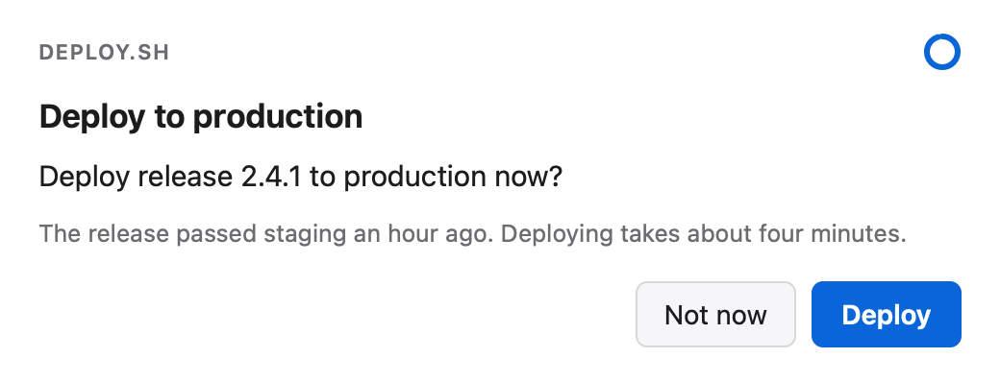
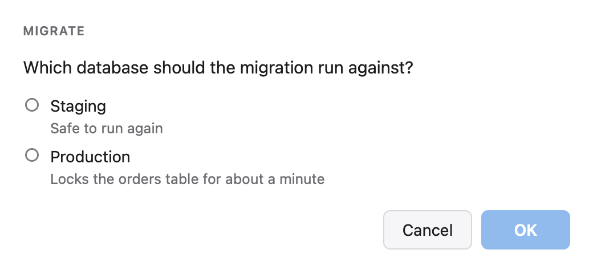
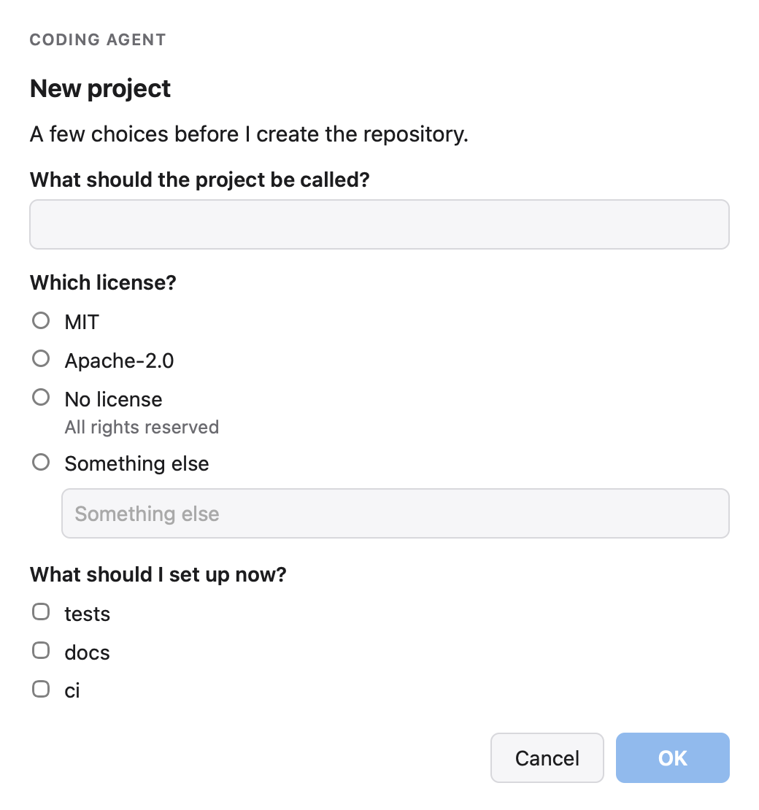
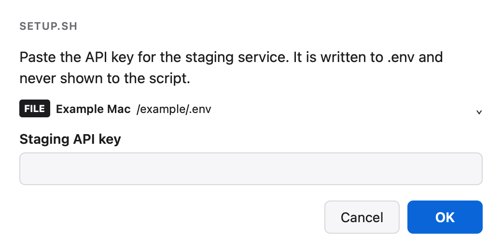
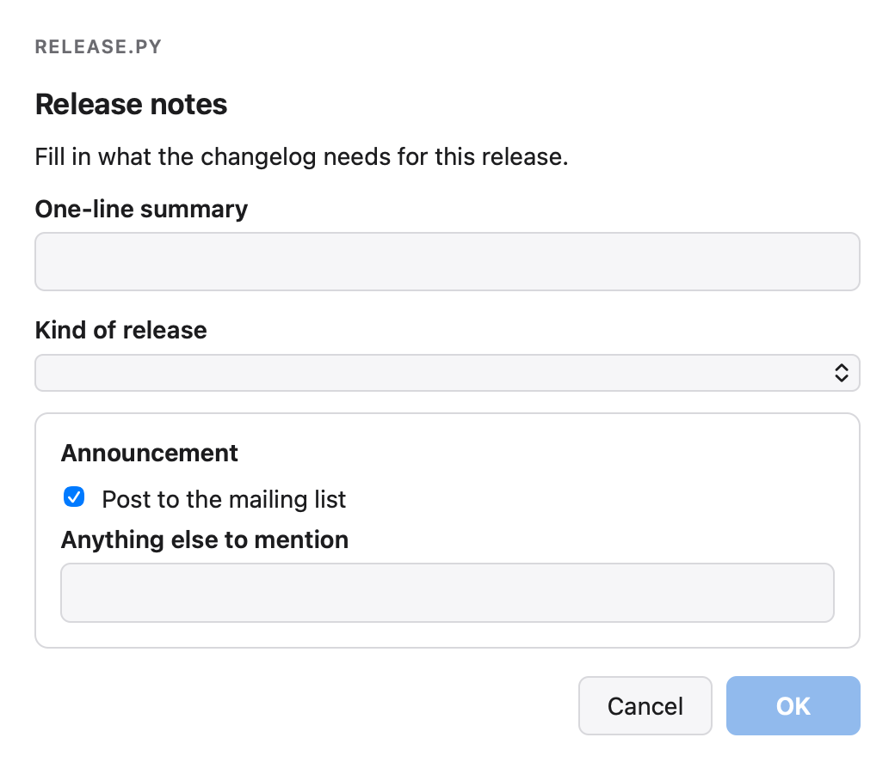
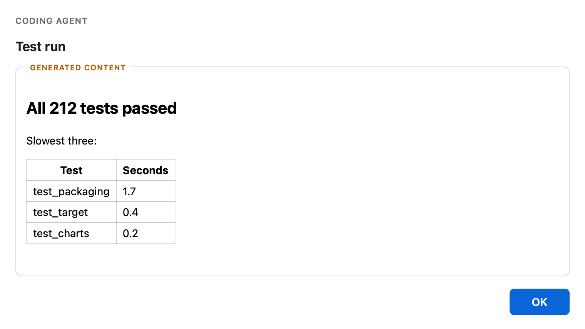
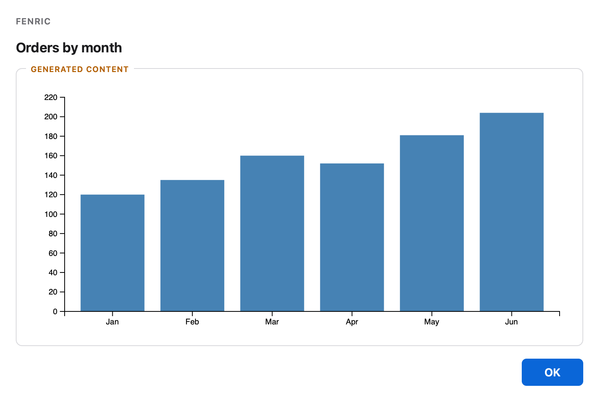
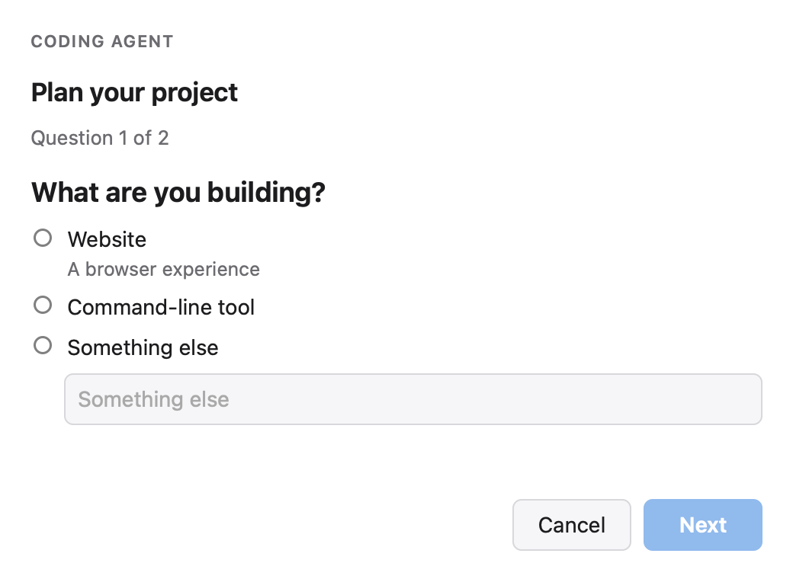
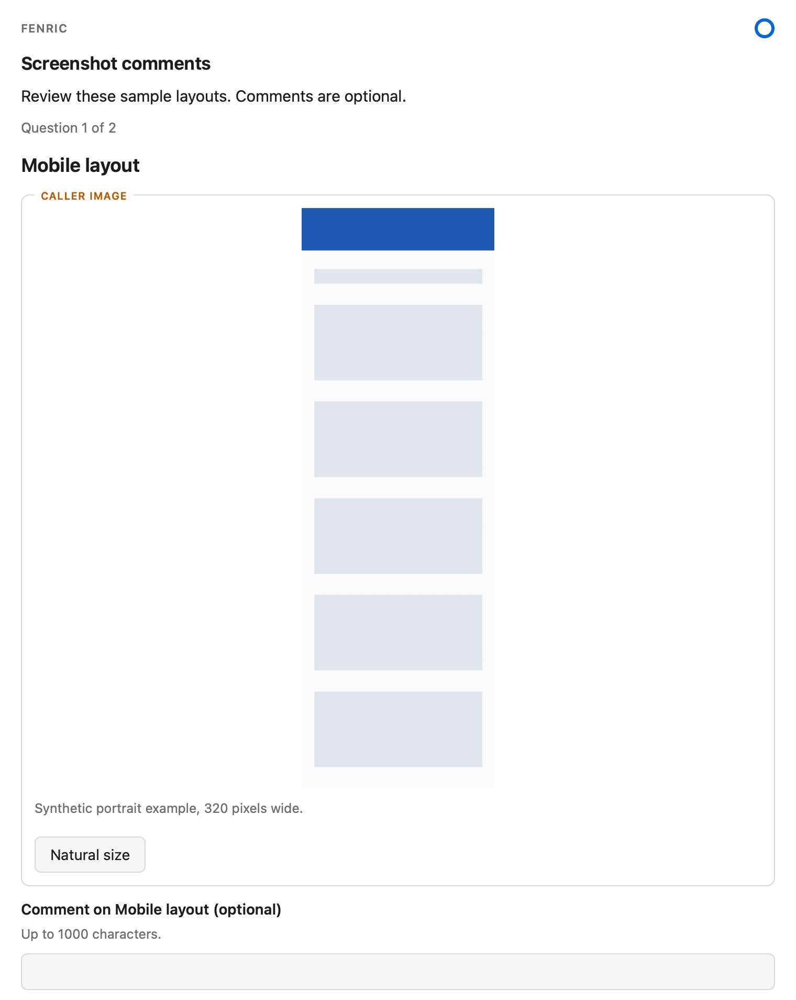

# Worked examples

Each example is a spec file in [`examples/`](examples/), the command that shows it, a picture of the dialog, and what Fenric prints for the answers described. The commands run from this `docs` directory, in a source archive or a checkout; elsewhere, copy the `examples` directory and run them beside it.

Nothing here is written by hand. Every picture is rendered from the command above it by Fenric's preview harness, in WebKit, the engine the macOS window uses; the native window draws its own title bar around the same page. Every output and file shown is captured from Fenric, and the tests rerun each one and fail if Fenric prints anything different.

## Confirm a deployment

A script asks before it does something it cannot take back. The window title and the small label above the dialog name the script, and the dialog expires after a minute if nobody touches it; the ring around the button shows the time left.

`examples/confirm.json`:

```json
{
  "verb": "confirm",
  "app": "deploy.sh",
  "title": "Deploy to production",
  "message": "Deploy release 2.4.1 to production now?",
  "detail": "The release passed staging an hour ago. Deploying takes about four minutes.",
  "yes_label": "Deploy",
  "no_label": "Not now",
  "timeout": 60
}
```

```bash
fenric --spec-file examples/confirm.json
```



<!-- capture {"answer": {"action": "yes", "values": {}}} -->
Pressing **Deploy** prints:

```text
true
fenric: remote: unavailable: not configured
```

<!-- capture {"answer": {"action": "no", "values": {}}} -->
Pressing **Not now** is an answer too, and also exits 0:

```text
false
fenric: remote: unavailable: not configured
```

<!-- capture {"answer": "expire", "exit": 4} -->
Left untouched, the ring drains and Fenric exits 4, so the script can fall back to asking some other way:

```text
unavailable: timed out
fenric: remote: unavailable: not configured
```

## Pick one option

Options can carry an id, which is what the result holds, and a line of detail under the label.

`examples/pick.json`:

```json
{
  "verb": "pick",
  "app": "migrate",
  "message": "Which database should the migration run against?",
  "options": [
    {"id": "staging", "label": "Staging", "detail": "Safe to run again"},
    {"id": "prod", "label": "Production", "detail": "Locks the orders table for about a minute"}
  ]
}
```

```bash
fenric --spec-file examples/pick.json
```



<!-- capture {"answer": {"action": "ok", "values": {"choice": 1}}} -->
Choosing **Production** and pressing OK prints the option's id, not its label:

```text
"prod"
fenric: remote: unavailable: not configured
```

## Ask several questions

An agent gathers what it needs in one window. The license question offers "Something else", so the person is not boxed in; the extras question allows any number of answers.

`examples/ask.json`:

```json
{
  "verb": "ask",
  "app": "Coding agent",
  "title": "New project",
  "message": "A few choices before I create the repository.",
  "questions": [
    {"id": "name", "prompt": "What should the project be called?"},
    {
      "id": "license",
      "prompt": "Which license?",
      "options": ["MIT", "Apache-2.0", {"id": "none", "label": "No license", "detail": "All rights reserved"}],
      "other": true
    },
    {"id": "extras", "prompt": "What should I set up now?", "kind": "multi", "options": ["tests", "docs", "ci"]}
  ]
}
```

```bash
fenric --spec-file examples/ask.json
```



<!-- capture {"answer": {"action": "ok", "values": {"q0": "orchard", "q1": "other", "q1.other": "MPL-2.0", "q2": [0, 2]}}} -->
Typing `orchard` as the name, choosing "Something else" and typing `MPL-2.0`, ticking **tests** and **ci**, and pressing OK prints one line of JSON keyed by question id:

```text
{"name":"orchard","license":"MPL-2.0","extras":["tests","ci"]}
fenric: remote: unavailable: not configured
```

<!-- capture {"answer": {"action": "ok", "values": {"q0": "orchard", "q1": 2, "q1.other": "", "q2": []}}} -->
Choosing **No license** and ticking nothing gives the option's id and an empty list:

```text
{"name":"orchard","license":"none","extras":[]}
fenric: remote: unavailable: not configured
```

<!-- capture {"answer": "cancel", "exit": 2} -->
Pressing Escape, or **Cancel**, prints:

```text
cancelled
fenric: remote: unavailable: not configured
```

## Write a secret into a file

A setup script needs a credential it should never see. Fenric writes it into `.env` in the current directory (a relative `into` is read from where Fenric runs), creating the file readable by its owner only when it does not exist yet, and replacing the key's value when it does.

`examples/secret.json`:

```json
{
  "verb": "secret",
  "app": "setup.sh",
  "message": "Paste the API key for the staging service. It is written to .env and never shown to the script.",
  "fields": [{"name": "STAGING_API_KEY", "label": "Staging API key"}],
  "into": ".env"
}
```

```bash
fenric --spec-file examples/secret.json
```



<!-- capture {"answer": {"action": "ok", "values": {"f0": "made-up-key-123"}}, "file": ".env"} -->
Pasting a key and pressing OK prints only a status:

```text
ok
fenric: remote: unavailable: not configured
```

and `.env` now holds the key:

```text
STAGING_API_KEY=made-up-key-123
```

<!-- capture {"answer": {"action": "ok", "values": {"f0": "made-up-key-456"}}, "setup": {".env": "STAGING_API_KEY=old-key\nDEBUG=1\n"}, "file": ".env"} -->
Run again where `.env` already has the key, only its value changes:

```text
ok
fenric: remote: unavailable: not configured
```

`.env` afterwards:

```text
STAGING_API_KEY=made-up-key-456
DEBUG=1
```

## Fill in a form

A form is built from the fixed component catalog in the [spec reference](spec.md#form-catalog-version-1). Inputs inside a card count like any other.

`examples/form.json`:

```json
{
  "verb": "form",
  "app": "release.py",
  "title": "Release notes",
  "components": [
    {"type": "text", "text": "Fill in what the changelog needs for this release."},
    {"type": "field", "id": "summary", "label": "One-line summary", "required": true},
    {"type": "select", "id": "kind", "label": "Kind of release", "options": ["patch", "minor", "major"], "required": true},
    {
      "type": "card",
      "title": "Announcement",
      "children": [
        {"type": "checkbox", "id": "announce", "label": "Post to the mailing list", "checked": true},
        {"type": "field", "id": "notes", "label": "Anything else to mention", "multiline": true}
      ]
    }
  ]
}
```

```bash
fenric --spec-file examples/form.json
```



<!-- capture {"answer": {"action": "ok", "values": {"c0": "Faster startup", "c1": 1, "c2": true, "c3": ""}}} -->
Typing `Faster startup` as the summary, choosing **minor**, leaving the checkbox ticked and the notes empty, and pressing OK prints:

```text
{"summary":"Faster startup","kind":"minor","announce":true,"notes":""}
fenric: remote: unavailable: not configured
```

## Show a report

HTML a model wrote is shown as static content: it is sanitized, shown in a frame that cannot run script, and marked as generated content. The [security model](security.md#generated-html) shows what the sanitizer removes.

`examples/custom.json`:

```json
{
  "verb": "custom",
  "app": "Coding agent",
  "title": "Test run",
  "html": "<h2>All 212 tests passed</h2><p>Slowest three:</p><table><tr><th>Test</th><th>Seconds</th></tr><tr><td>test_packaging</td><td>1.7</td></tr><tr><td>test_target</td><td>0.4</td></tr><tr><td>test_charts</td><td>0.2</td></tr></table>",
  "height": 260
}
```

```bash
fenric --spec-file examples/custom.json
```



<!-- capture {"answer": {"action": "ok", "values": {}}} -->
Pressing OK prints:

```text
ok
fenric: remote: unavailable: not configured
```

## Draw a chart

A chart is TypeScript that draws with d3 into `root`, using `data`; both are globals. The code is type-checked and compiled before the window opens. Charts use the same ordinary DOM/d3 on native and configured remote surfaces, and need the one-time `fenric setup-charts` described in the [command reference](commands.md#setup-charts).

[`examples/chart.ts`](examples/chart.ts) draws one bar per month; click or tap a bar to change its color. It reads [`examples/orders.json`](examples/orders.json):

```bash
fenric chart --code-file examples/chart.ts --data-file examples/orders.json --title "Orders by month" --height 340
```

Add `--timeout 30` to try the shared countdown: opening the remote URL leaves it running; tapping a bar cancels the countdown and leaves a solid subdued ring on both surfaces. Close with OK or Escape. The caller may also cancel the request.



<!-- capture {"answer": {"action": "ok", "values": {}}} -->
Pressing OK prints:

```text
ok
fenric: remote: unavailable: not configured
```

## Ask one question at a time

Choose this explicit wizard layout for several substantial decisions instead of stacking them in one long form. Four questions alone do not select it: the `ask` spec must include `"presentation":"wizard"`. Ordinary `ask` forms and catalog `form` cards keep their existing behavior.

The progress count includes only currently active questions, so it changes when a choice opens a branch. The wizard keeps answers while you go Back or edit them from the final review. Changing the target discards answers in the old branch. Returning to that branch asks for fresh answers. No answer is submitted until you press Submit on the review page.

`examples/ask-wizard.json`:

```json
{
  "verb": "ask",
  "app": "Coding agent",
  "title": "Plan your project",
  "presentation": "wizard",
  "questions": [
    {
      "id": "target",
      "prompt": "What are you building?",
      "options": [
        {
          "id": "web",
          "label": "Website",
          "detail": "A browser experience"
        },
        {
          "id": "cli",
          "label": "Command-line tool"
        }
      ],
      "other": true
    },
    {
      "id": "audience",
      "prompt": "Who will use the website?",
      "when": {
        "question": "target",
        "equals": "web"
      }
    },
    {
      "id": "command",
      "prompt": "What should the command do?",
      "when": {
        "question": "target",
        "equals": "cli"
      }
    },
    {
      "id": "notes",
      "prompt": "Anything else?",
      "multiline": true,
      "required": false
    }
  ]
}
```

```bash
fenric --spec-file examples/ask-wizard.json
```



<!-- capture {"answer": {"action": "ok", "values": {"q0": 0, "q0.other": "", "q1": "New contributors", "q3": ""}}} -->
Choosing **Website**, answering the audience question and leaving the optional note blank prints only the active answers:

```text
{"target":"web","audience":"New contributors","notes":""}
fenric: remote: unavailable: not configured
```

## Comment on screenshots

A requesting agent selects representative PNGs and gives each a stable ID, name and caption. These two bundled images are synthetic layout examples, not Tower screenshots. Keep the manifest beside the images, or use paths relative to it. Set a longer timeout for a phone review; this example allows an hour. Comments remain drafts until Submit on the final review page.

`examples/image-comments.json`:

```json
{
  "title": "Screenshot comments",
  "message": "Review these sample layouts. Comments are optional.",
  "timeout": 3600,
  "images": [
    {
      "id": "mobile",
      "name": "Mobile layout",
      "caption": "Synthetic portrait example, 320 pixels wide.",
      "file": "gallery-first.png"
    },
    {
      "id": "wide",
      "name": "Wide layout",
      "caption": "Synthetic landscape example, 1280 pixels wide.",
      "file": "gallery-second.png"
    }
  ]
}
```

```bash
fenric ask --gallery-file examples/image-comments.json
```



<!-- capture {"answer": {"action": "ok", "values": {"q0": "Enlarge the primary button.", "q1": ""}}} -->
Commenting on Mobile layout and leaving Wide layout blank prints:

```text
{"mobile":"Enlarge the primary button.","wide":""}
fenric: remote: unavailable: not configured
```

On a machine with remote already configured, the same gallery is available through the temporary authenticated phone URL. The requesting agent reads stdout once and matches each key to the manifest; comments do not authorize another operation. Reload, browser eviction, Cancel and expiry do not save partial comments. A native render failure ends the shared session, and `FENRIC_HEADLESS=1` refuses before either surface starts, so a remote deployment must meet the existing [installation](../README.md#install) and [remote prerequisites](commands.md#remote-access). This example neither enables remote nor changes access.
