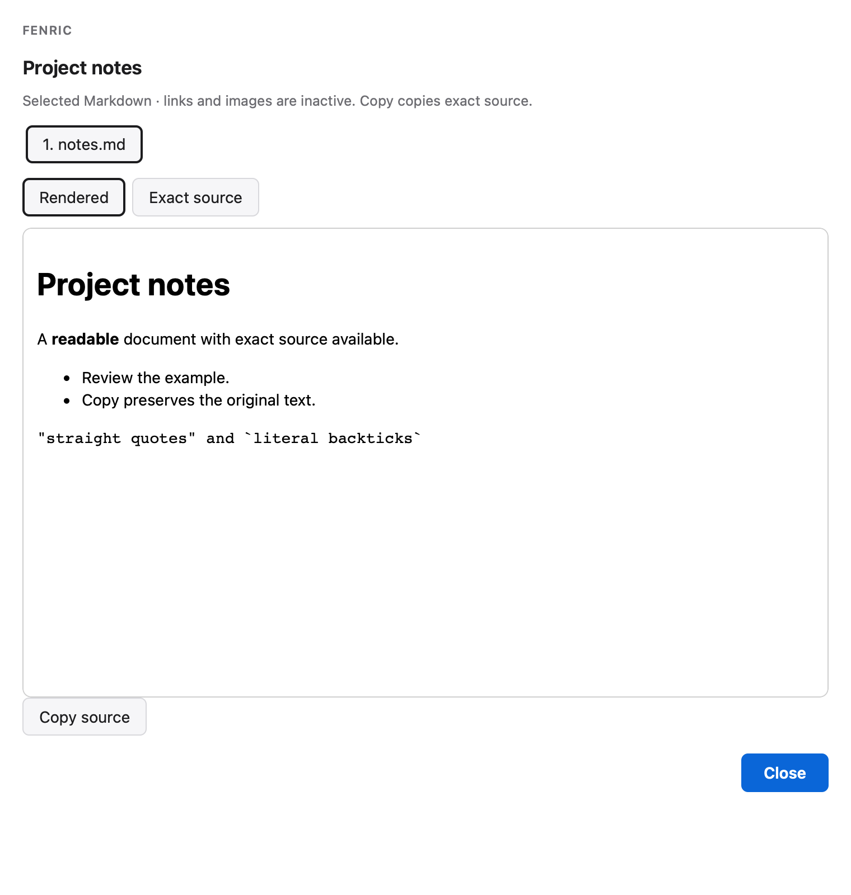

# Read Markdown documents

The development source adds a first-class `markdown` viewer. Published versions through 0.3.0 do not include it. Select one or more local `.md` or `.markdown` files, switch between Rendered and Exact source, and use Copy source for the original document text. Document tabs support Left/Right, Home/End and ordinary Tab navigation. The desktop window is resizable; long content scrolls on desktop and phone.

```bash
fenric markdown --file examples/notes.md --title "Project notes"
```



<!-- capture {"answer":{"action":"ok","values":{}}} -->
Close acknowledges presentation and prints:

```text
ok
```

Repeat `--file` for each explicitly selected document. `--view source` starts in Exact source; the default is `rendered`. `--height` sets the initial content height (100–2000, default 420); `--title`, `--app` and `--timeout` have their usual meanings. Paths are relative to the invoking process, including when a JSON spec is read from another directory. There is no directory scan, glob expansion by Fenric, include directive or implicit neighbor access.

Equivalent JSON spec fields are:

```json
{"verb":"markdown","files":["notes.md","decisions.markdown"],"view":"rendered","height":420,"title":"Documents","timeout":300}
```

Selection is bounded to 16 documents, 256 KiB per file and 1 MiB total. Each must be a regular UTF-8 file without NUL; empty documents are supported. Symlink files/components, parent traversal, unreadable files and changing/oversized reads are refused before opening a window. Only basenames appear as document labels. Files are snapshotted once: later disk edits do not change either view or Copy within that invocation. Reopen explicitly for a new revision.

Headings, emphasis, lists, quotations, code blocks, tables and strikethrough are rendered by the locked Mistune parser. Raw HTML is shown as text. Links remain inactive text and images become descriptive text: neither local nor remote targets are fetched. Markdown cannot run scripts, forms, extensions or directives. Rendered output passes through Fenric's existing allowlist sanitizer and lives in a scriptless opaque frame with network access blocked. The general custom sanitizer and selected-HTML execution policy are unchanged.

Copy source uses the original UTF-8 text, including a BOM, CRLF, quotes, indentation, blank lines and final newline, without fences, trimming or typography substitutions. Clipboard platforms may normalize line endings. On clipboard failure, Exact source becomes visible and selectable, and the UI reports the failure; a button click alone never proves clipboard success. Rendered text and Copy source are deliberately different representations.

Use the receiving host's installed `fenric markdown --help` to check availability first. Retain one tracked invocation, optionally using the existing `--remote-status-file` contract; promptly relay its actual protected URL and immutable expiry through the already authorized channel. Read the terminal result of that same invocation and clean up only its owned resources. Existing owner-only tailnet authentication, cancellation, expiry and private lifecycle apply unchanged. A URL, Copy, Close or `ok` grants no permission and proves no downstream action. This viewer does not install a hook, publish a document or settle a native approval.

The inert rendering policy drops ordered-list start values and table alignment; an ordered list starting above 1 displays from 1 and aligned columns use ordinary table layout. Exact source remains unchanged. `--height` requests 100–2000 pixels, but the responsive content viewport has a 160-pixel minimum and a 65vh maximum (the minimum wins on extremely small viewports). Markdown preparation precedes the dialog timer; input-size limits are not a universal CPU-time guarantee. Tested maximum-size adversarial bracket/emphasis cases are recorded in qualification.

Symlink rejection also applies to macOS convenience aliases such as `/tmp` and `/var`; select their canonical `/private/tmp` or `/private/var` paths instead. POSIX no-follow file operations are required; unsupported platforms return a value-free refusal rather than weakening the read policy. Native GUI support on other platforms remains unverified.
