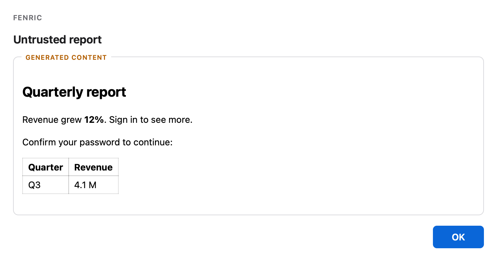

# Security model

Fenric is built for callers that compose what a person sees — often a model — so it treats everything in a spec as untrusted, and everything a window hands back as untrusted too. The caller says *what* to ask; Fenric decides how it is shown, what it may do, and what may come back.

## Who is trusted

- **Trusted:** Fenric's own code, the page it authors around every dialog, and the person at the machine.
- **Untrusted:** every value in a spec, the HTML given to `custom`, the code and data given to `chart`, and anything read back from a window.
- **Not defended against:** the calling program itself, the store command it names, and anything else that can already read or write the file it names. A program that can run Fenric can already run anything else as the same user; Fenric protects the person and the answer, not the machine from its own user.

## What comes back

Fenric returns a validated value or a status word, never the content it showed. Every answer is checked against the spec that asked for it — choices come back from the window as positions in the list and are turned into ids by Fenric, and an answer the spec did not ask for is refused (exit 3). The page has nothing a script could call: Fenric reads the answer from outside it.

Error messages are value-free. A refusal names the field by a path such as `fields[0].name` and never quotes its content, a command-line argument, a file path, a compiler message, a store command's output, or anything the person typed.

```bash
fenric --spec '{"verb": "secret", "fields": ["my secret token"], "store": "pass insert {name}"}'
```

<!-- capture {"exit": 3} -->
The field is named by its position; the bad name itself is not repeated:

```text
fenric: error: fields[0].name may hold only letters, digits, dot, underscore and hyphen
```

## Generated HTML

An `ask` text question may show a bounded inline static PNG in the page, visibly labeled **Caller image** outside the pixels, including at final review. Names and captions are escaped; the image adds no network access or result channel. The gallery loader bounds regular-file reads and validates PNG framing, checksums and dimensions before a window opens; the browser must decode the image before its answer can be submitted.

`custom` content is sanitized against an allowlist and shown in a frame that runs no script at all. Headings, paragraphs, lists, tables, emphasis, code, quotations and figures survive; an image survives only as an inline `data:` PNG, JPEG, GIF or WebP. Script, style, frames, media, SVG, buttons, text areas, drop-down lists and anything else that can carry active or external content is removed with everything inside it. Every other element not on the list, such as a form wrapper or a link, is removed but keeps its contents, which are sanitized the same way; a form's paragraphs survive, its buttons do not. Only a handful of inert attributes are kept: no `style`, no `class`, no event handlers, no links.

[`examples/untrusted.html`](examples/untrusted.html) is a report with a script that sends cookies away, a form asking for a password, a link, an inline style with a click handler, and a tracking image:

```bash
fenric custom --title "Untrusted report" --height 230 --html-file examples/untrusted.html
```



<!-- capture {"answer": {"action": "ok", "values": {}}} -->
What reaches the screen is the heading, the paragraphs, the link's text and the table. The form's own paragraph survives as text; its password box, its button, the script and the image are gone. Pressing OK prints:

```text
ok
```

## Selected HTML bundles

`html` preserves caller-selected HTML and presentation asset bytes instead of using the `custom` sanitizer. It reads an exact bounded manifest of regular files before display, refuses symlink components and traversal, and never serves a directory or reads paths from HTTP. The generated badge and result controls remain outside an opaque `allow-scripts` frame. Every selected resource carries a policy restricted to its own fresh file-capability prefix, including after relative navigation: selected scripts/styles/data are usable; external networking, parent access, unsafe-eval, forms, popups, workers and nested frames are not granted. Inline script/style and data/blob images/fonts are permitted. Scripts have no answer/touch adapter or native authority. Acknowledging the outer dialog is presentation only.

Desktop uses a short-lived loopback asset listener with a separate random capability; it exposes no page, state or action endpoint. The phone outer page permits same-origin frames because its final receiving host is selected during remote setup; every selected document still has its own absolute file-prefix resource policy. Phone assets require both their separate file capability and the existing authenticated Tailscale host/login checks. Neither content nor source filenames are logged. Only bounded snapshots are served; reads stop at settlement/expiry and listeners close with their owning invocation. The caller still owns choosing nonsecret presentation material; file type checks cannot identify raw provider records or confidential data. See [exact bounds](spec.md#html).

## Charts

`chart` code is type-checked and compiled before any window opens, and a type error is exit 3. For example, [`examples/broken-chart.ts`](examples/broken-chart.ts) assigns a string to a number:

```bash
fenric chart --code-file examples/broken-chart.ts
```

<!-- capture {"exit": 3} -->
It is refused before any window opens, and the compiler's own message is not passed on, since it would quote the code:

```text
fenric: error: the chart code did not pass the type check
```

A compiled chart runs in its visibly generated opaque-origin frame with real DOM/d3 and ordinary browser networking. Neither chart document emits a CSP; browser TLS/CORS and permission rules apply. The retained sandbox does not grant same-origin parent access, origin storage, popups or form submission. Data remains parsed from JSON, never pasted into code, and no native Python/filesystem API or structured chart return is added. Non-chart chrome and custom HTML retain their exact restricted policies.

The native bridge/print receiver guard remains macOS-only; the obsolete no-network peer/media preferences and chart platform refusal are retired under the operator's2026-10-12 ruling. Earlier containment probes are historical, not a current promise. The shared deadline/result/direct-sink boundaries remain. Genuine chart input reports touch through its fixed source-checked parent adapter; load, focus, resize and network activity do not. Cooperative chart code can deliberately report touch; this is not a Byzantine caller defence.

## Generated content is marked

Every frame that holds caller-composed content sits in a bordered area with a "Generated content" badge, drawn by Fenric outside the frame where the content cannot cover or restyle it. Text from a spec that appears in Fenric's own part of the dialog is escaped, so a spec cannot draw something that passes for Fenric's own prompt.

## Nothing waits forever

Every window has a hard time limit, enforced from outside the page, so a script that never yields cannot hold it open: 300 seconds by default, or, with a timeout of N seconds, N + 12 seconds or 300 seconds, whichever is later (the [command reference](commands.md#time-limits) gives the details). Each chart toolchain step is limited to 120 seconds and each store command to 30.

## Secrets

A secret typed into Fenric never reaches the caller's standard output, standard error, or exit status.

- The `secret` dialog is written by Fenric from field names and labels; a caller cannot supply markup or a value. Fields are masked, with autofill, autocorrect and spellcheck off.
- A secret request needs exactly one destination: a store command, or a file target.
- A **store command** runs without a shell, once per filled field, with the value on its standard input. Its output is discarded.
- A **file target** is written only in a format Fenric recognized by parsing it: a dotenv or direnv file, a flat JSON object of strings, or a single value. Anything else is refused before the dialog opens, so the person is never asked for a secret that would be thrown away, and the file is left as it was.
- A value is written only in a form every reader of that file loads unchanged; a value with no such form is refused, not approximated.
- The update is all or nothing. The new content goes to a temporary file readable by its owner only, which takes the target's owner, group and mode once complete and is then renamed over the target, so a reader sees the old file or the new one, never part of either. An existing file keeps its permissions; a file Fenric creates is readable by its owner only.
- Fenric keeps no reference to a value after the store call or the file update, and writes none to a log or a fallback file.

The exact formats and refusals are in the [spec reference](spec.md#the-file-target).

## Reporting a problem

See [`SECURITY.md`](../SECURITY.md).

## Temporary remote surface

Remote access is explicit machine configuration. A temporary loopback-only listener is published through tailnet-only HTTPS Serve, never Funnel. A fresh session token, the node owner's Tailscale login, matching host/HTTPS metadata and exact same-origin JSON requests protect the endpoint. Tagged or ownerless nodes cannot publish it. Responses are uncached and referrer-free; fixed errors do not reflect request values. The server logs no request lines or tracebacks. Local machine processes are trusted as proxy peers, like the calling program.

Non-chart remote chrome receives only same-origin requests and custom remains inert. Chart pages have ordinary browser networking and no outer/inner CSP on desktop and phone; opaque-frame parent separation and the macOS main-frame receiver guard remain. No new native/device or Tailscale grants are added. A shared reservation executes sinks exactly once and records only terminal status for the remote page, never an answer or typed secret. Invalid requests do not settle. Every secret dialog shows the receiving host and exact resolved destination in trusted chrome, with touch/keyboard details. A path that resolves elsewhere after display is refused before any write. A command description is visibly generated, and Fenric infers no destination from it.

A single clock, interaction state and deadline cover both surfaces. Opening or reloading does not count as interaction. The caller may cancel; handled endings and parent death stop the session's owned foreground Serve child, preserving other mappings. Network/setup/announcement operations are bounded. Following settlement the address allows a bounded 0.5-second acknowledgement window for outcome replay, then disappears. Remote HTTP replies contain no answer. Readiness probes ignore unrelated environment proxies and verify HTTPS certificates.

Each browser page uses an opaque request marker. A losing page is told the dialog completed on another surface; it does not claim that its own entered value was stored. Retrying the same marker returns that recorded acknowledgement and never runs a sink twice. Markers and answers are not echoed in responses.

The browser stops after three consecutive failed exchanges, waiting 0.5 then 1 second between retries; a successful exchange resets the failure count. Each request still has a 3-second timeout. On disconnection it removes stale controls and reports the response as unconfirmed, rather than claiming approval, cancellation or proved expiry. The server's original result and deadline remain unchanged: a lost acknowledgement may follow a completed effect and outlast the server’s short replay window, so recovery is not guaranteed. The caller must reconcile its own result before retrying an operation.
