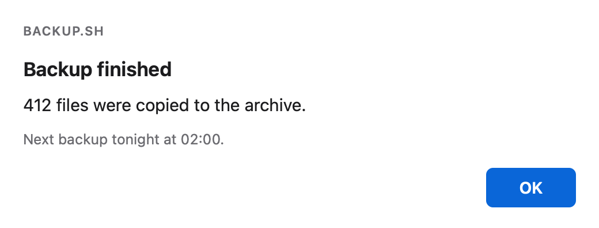
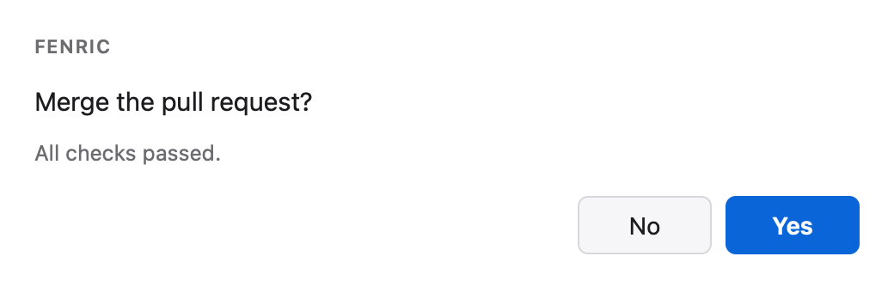
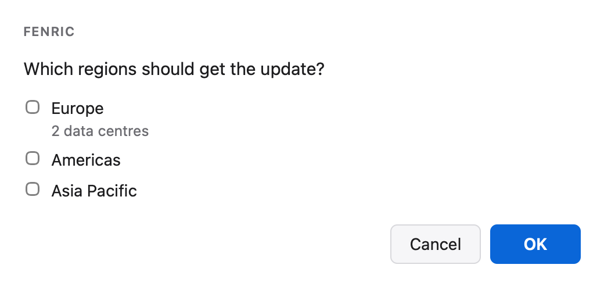
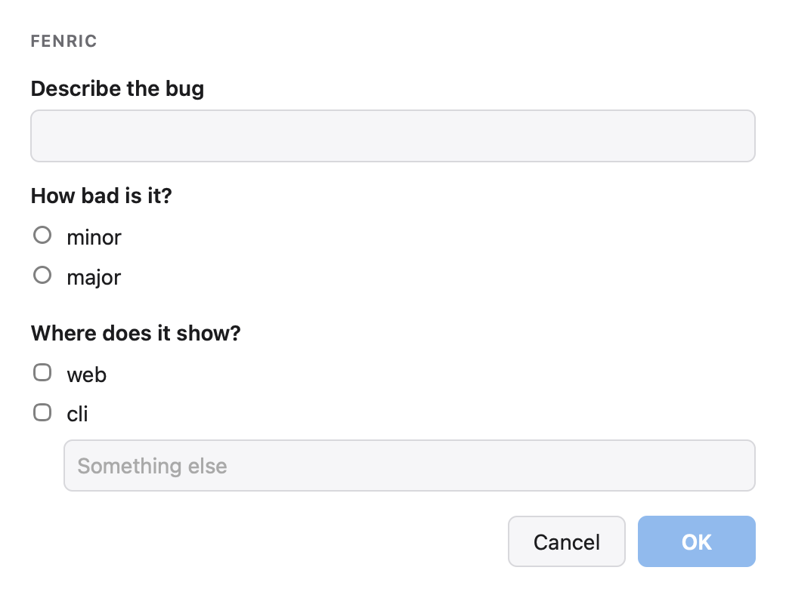
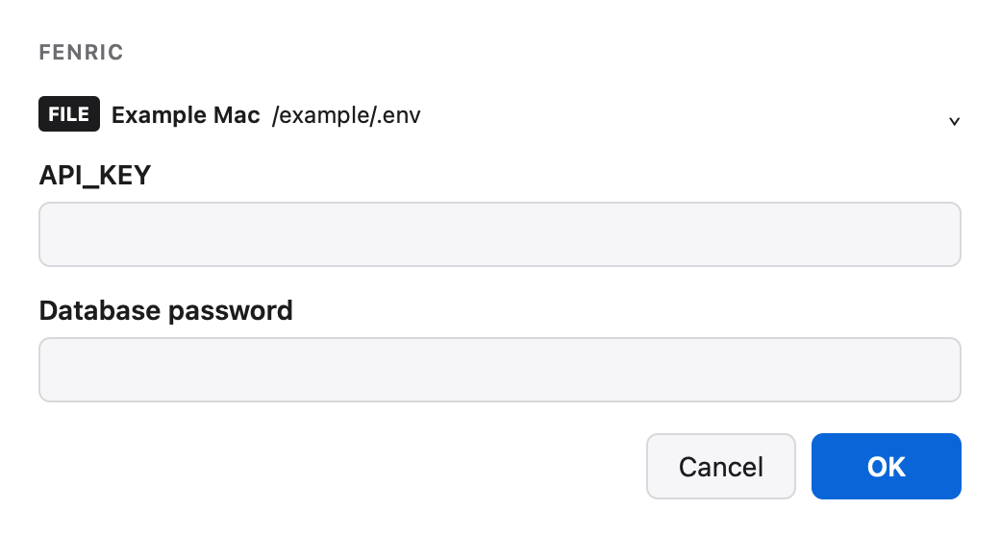
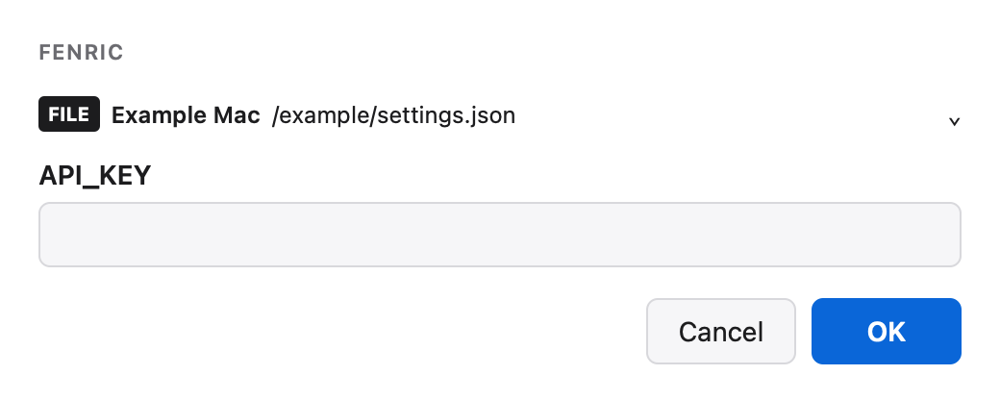
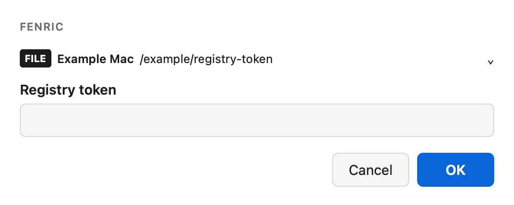
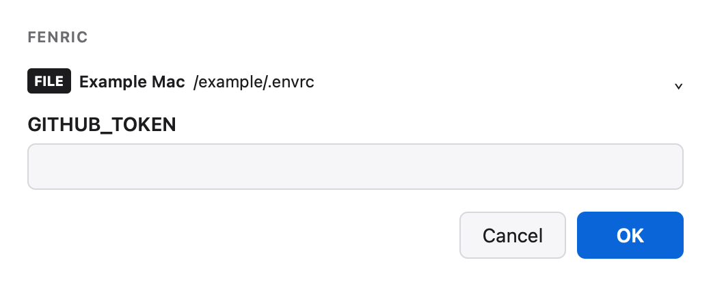
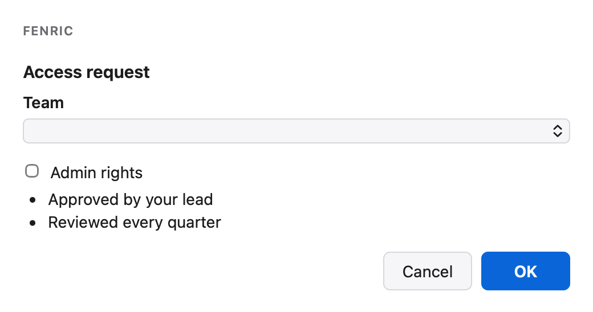

# Spec reference

For worked human-interaction recipes and decision/comment handling, read the [packaged agent guide](../fenric/_guidance/fenric/guide.md), also available offline through `fenric guidance read`.

A spec is one JSON object: a `verb` and that verb's fields. It is what `--spec` and `--spec-file` take, what the library's `run` takes as a mapping, and what the verb options of the [command](commands.md) fill in. This page lists every field, what each verb returns, and form catalog version 1.

## Every spec

| Field | Type | Meaning |
|---|---|---|
| `verb` | string, required | One of `notify`, `confirm`, `pick`, `ask`, `secret`, `form`, `custom`, `chart`. |
| `app` | string | Who is asking: the window title and the label above the dialog. Default `Fenric`. |
| `timeout` | number | Seconds before an untouched dialog expires. Greater than 0, at most 3600. |

A spec is strict: a field the verb does not define is refused, a string field must not be empty, and ids must be unique wherever they key a result. A refusal is exit 3 and names the field by its path, such as `questions[1].options`, never by its content.

```bash
fenric --spec '{"verb": "pick", "message": "Which?", "options": []}'
```

<!-- capture {"exit": 3} -->
An empty list is refused, named by its path:

```text
fenric: error: options must be a non-empty list
```

```bash
fenric --spec '{"verb": "ask", "questions": [{"id": "q", "prompt": "Why?", "kind": "text", "options": ["a"]}]}'
```

<!-- capture {"exit": 3} -->
So is a field that does not fit the rest of the spec:

```text
fenric: error: questions[0] a text question takes no options
```

## Verbs

### notify

| Field | Type | Meaning |
|---|---|---|
| `title` | string | A heading inside the dialog. |
| `message` | string, required | The message. |
| `detail` | string | Secondary text. |
| `copy_text` | nonblank UTF-8 string | Optional literal payload in a selectable plain-text view with a Copy button. Copy writes only this payload and does not settle the dialog. |

Result: the status `ok`.

```bash
fenric --spec '{"verb": "notify", "app": "backup.sh", "title": "Backup finished", "message": "412 files were copied to the archive.", "detail": "Next backup tonight at 02:00."}'
```



<!-- capture {"answer": {"action": "ok", "values": {}}} -->
Pressing OK prints:

```text
ok
fenric: remote: unavailable: not configured
```

### confirm

| Field | Type | Meaning |
|---|---|---|
| `title` | string | A heading inside the dialog. |
| `message` | string, required | The question. |
| `detail` | string | Secondary text. |
| `yes_label` | string | The yes button's label. Default `Yes`. |
| `no_label` | string | The no button's label. Default `No`. |

Result: `true` or `false`. Answering no is an answer and exits 0; closing the window or pressing Escape is a cancel.

```bash
fenric --spec '{"verb": "confirm", "message": "Merge the pull request?", "detail": "All checks passed."}'
```



<!-- capture {"answer": {"action": "yes", "values": {}}} -->
The buttons default to **No** and **Yes**; pressing **Yes** prints:

```text
true
fenric: remote: unavailable: not configured
```

### pick

| Field | Type | Meaning |
|---|---|---|
| `title` | string | A heading inside the dialog. |
| `message` | string, required | The prompt. |
| `options` | list, required | See [Options](#options). |
| `multiple` | boolean | Allow several choices. Default false. |

Result: the chosen option's id, or with `multiple` a list of ids in the options' order, which may be empty.

```bash
fenric --spec '{"verb": "pick", "message": "Which regions should get the update?", "multiple": true, "options": [{"id": "eu", "label": "Europe", "detail": "2 data centres"}, {"id": "us", "label": "Americas"}, {"id": "ap", "label": "Asia Pacific"}]}'
```



<!-- capture {"answer": {"action": "ok", "values": {"choice": [2, 0]}}} -->
Ticking **Asia Pacific** and **Europe** prints their ids, in the options' order:

```text
["eu","ap"]
fenric: remote: unavailable: not configured
```

<!-- capture {"answer": {"action": "ok", "values": {"choice": []}}} -->
Ticking nothing is an answer too:

```text
[]
fenric: remote: unavailable: not configured
```

### ask

| Field | Type | Meaning |
|---|---|---|
| `title` | string | A heading inside the dialog. |
| `message` | string | Text above the questions. |
| `presentation` | string | `form` (default, all at once) or `wizard` (pages followed by review). |
| `questions` | list, required | One or more questions. |

A question:

| Field | Type | Meaning |
|---|---|---|
| `id` | string, required | The key of this answer in the result. |
| `prompt` | string, required | The question. |
| `detail` | string | Secondary text. |
| `kind` | string | `text`, `choice` or `multi`. Default `choice` when `options` is given, otherwise `text`. |
| `options` | list | Required for `choice` and `multi`; not allowed for `text`. See [Options](#options). |
| `other` | boolean | `choice` and `multi` only. Adds a "Something else" choice beside an always-visible text box. |
| `multiline` | boolean | `text` only. |
| `image` | object | Text only: inline PNG data and alternative text; see Images below. |
| `when` | object | Wizard only: show this question when an earlier offered option is selected; see below. |
| `required` | boolean | Default true for `text` and `choice`, false for `multi`. |

Offer `other` unless the answer really is a closed set, so the person is never boxed in.

Result: an object keyed by question id. A `text` answer is the string as typed. A `choice` answer is the chosen option's id, or the typed text when "Something else" was chosen, or `null` when a question that is not required was left unanswered. A `multi` answer is a list of ids in the options' order, followed by the typed text when the box was filled in. Typed text is not marked as typed, so do not use an id a person might also type.

```bash
fenric --spec '{"verb": "ask", "questions": [{"id": "summary", "prompt": "Describe the bug", "multiline": true}, {"id": "severity", "prompt": "How bad is it?", "options": ["minor", "major"], "required": false}, {"id": "areas", "prompt": "Where does it show?", "kind": "multi", "options": ["web", "cli"], "other": true}]}'
```



<!-- capture {"answer": {"action": "ok", "values": {"q0": "Login fails\nafter an update.", "q1": null, "q2": [1], "q2.other": "the API"}}} -->
Typing two lines, leaving the optional severity unanswered, ticking **cli** and typing `the API` in the box prints:

```text
{"summary":"Login fails\nafter an update.","severity":null,"areas":["cli","the API"]}
fenric: remote: unavailable: not configured
```

For several substantial decisions, choose `"presentation":"wizard"` explicitly. Omitting the field keeps the all-at-once form, regardless of question count. This layout belongs to `ask`; catalog `form` components are not automatically converted. The final review may still be long and remains scrollable.

#### Images and screenshot galleries

A text question may carry `image: {"data": "data:image/png;base64,...", "alt": "Description"}`. Both keys are required; only static inline PNG is accepted. The image appears inside a labeled **Caller image** area. It can illustrate either a form or wizard question; its comment is the usual string keyed by the question ID. Image questions accept at most 1000 UTF-16 code units per comment (most characters count as one; emoji can count as two). Existing questions without images have unchanged limits and behavior.

The image fits its page without cropping. **Natural size** toggles a bounded scrolling area for inspection; press it again to restore the fitted view. Its pressed state indicates natural-size mode. Inspecting through that button counts as deliberate interaction and cancels the countdown. An image that is still loading or fails to decode blocks progression and submission. Cancel and request a corrected gallery if an image cannot be displayed. Review shows each image thumbnail, its name, comment and Edit button. Back/Next/Edit retain comments only within the open page; reloading or a browser discarding the tab starts a fresh draft. Cancel, Escape and native close return no partial comments.

Limits: 10 images, 2 MiB decoded PNG bytes per image, 8 MiB combined, 8192 pixels on either side, 16 million pixels per image and 24 million pixels combined. PNG framing and checksums are validated before display; the browser decodes the pixels. SVG, animated PNG and network image URLs are refused. These are input bounds, not a promise that every native renderer can display the largest page; macOS is the verified native platform, and Linux/Windows GUI behavior remains unverified. Use a representative selection of reasonably sized screenshots on phones.

For local files, `fenric ask --gallery-file manifest.json` builds this wizard for you. The manifest is a JSON object with an `images` list and optional `title`, `message`, `app`, and `timeout`. Each entry requires unique nonempty `id`, `name`, and `file`; `caption` is optional nonempty text, and `required` is an optional boolean defaulting to false. Files resolve relative to the manifest; absolute paths also work. A manifest is at most 64 KiB and all inputs must be regular files. There is no glob expansion or image fetching. `--gallery-file` cannot be combined with `--spec`, `--spec-file`, or `--question`; command-line title/message/app/timeout can override the manifest.

Results are `{image-id: comment}` in display order, including `""` for optional blanks. Reordering the manifest does not change which ID owns a comment. The ten-image and comment bounds keep even worst-case JSON escaping (10 × 1000 × 6 bytes, plus the fixed input keys and envelope) below the remote 65536-byte request limit. This guarantee applies to manifest galleries; unrelated unbounded text questions in a custom ask spec still share that transport limit.

Use `"timeout": 3600` for a longer screenshot review. Without a timeout every session has a 300-second hard limit, even after interaction. With a timeout, untouched expiry uses that timeout and the external safety deadline allows another 12 seconds; after interaction the hard limit is `max(300, timeout + 12)` seconds from session start. Expiry discards unsubmitted comments. The [worked gallery example](examples.md#comment-on-screenshots) sets 3600.

Library callers use `from fenric import load_gallery, run`, then `result = run(load_gallery("manifest.json"))`. The helper returns a validated ordinary ask specification and raises a value-free `SpecError` on invalid input; it does not open a dialog. The manifest, local paths and image bytes are never included in the structured result or error text.

#### Wizard navigation and conditions

Every wizard, including one with a single active question, ends with a review page. Next validates the current question; Back retains active answers. Edit on review returns to a question. Submit validates all active questions and returns the same ID-keyed answer types as an ordinary ask. Cancel, Escape and closing the native window discard the dialog without a partial result. Enter advances a single-line question; multiline Enter inserts a newline. Tab reaches the controls and navigation buttons; Enter on a button activates that button. On review, focus Submit to submit with Enter; Enter on the review heading does nothing.

`when` has exactly two fields:

| Field | Type | Meaning |
|---|---|---|
| `question` | string, required | ID of an earlier question. |
| `equals` | string | Offered option ID of an earlier `choice` question. Mutually exclusive with `includes`. |
| `includes` | string | Offered option ID of an earlier `multi` question. Mutually exclusive with `equals`. |

A condition is true only when its source question is active and the named offered option is selected. Unanswered choices, empty selections and typed Other text do not match; typing an option ID does not select that option. Self, forward, unknown and text-question references, wrong comparison kinds and unknown option IDs are refused with value-free field paths. Conditions in `form` presentation are refused.

Changing a choice immediately clears any question it hides, including dependent branches. Reactivating a branch starts it empty. The result contains only active question IDs; hidden raw payload keys are rejected by Python validation. Optional active questions keep the usual empty string, null or empty-list result and are marked unanswered on review.

Drafts last for the current open page only. Reloading or opening another surface starts fresh; drafts are not shared between surfaces. The first surface to submit settles the request. No choice executes an approval or other action.

### secret

| Field | Type | Meaning |
|---|---|---|
| `title` | string | A heading inside the dialog. |
| `message` | string | Text above the fields. |
| `fields` | list, required | Each a name, or an object with `name` and an optional `label`. A name may hold letters, digits, dot, underscore and hyphen. |
| `store` | string | The store command. `{name}` in any argument is replaced by the field's name. |
| `store_label` | string | Optional description, allowed only with `store`; escaped, quoted and marked as generated. |
| `into` | string | The file target: a path, in which a leading `~` is expanded. A relative path is relative to the directory Fenric runs in. |

Exactly one of `store` and `into` is required. A field left empty is skipped by both. Result: the status `ok`. No value is ever part of the result, of an error message, or of the exit status.

The store command is split the way a shell splits a command line, but no shell runs it. It runs once for each field the person filled in, with the value on its standard input, and its output is discarded.

#### The file target

Each filled field is written into the file under the field's name. The file's format is decided from its content, in this order:

| Format | Recognized by | Update |
|---|---|---|
| flat JSON | The first non-blank character is `{` or `[`. It must parse as one object whose values are all strings and whose keys are unique. | The file is edited as text: an existing member's value is replaced, a new member is added after the last with the same separator and indentation. Layout, member order and existing escape spellings are kept. |
| dotenv | Every non-blank line is a `#` comment or begins with an optional `export`, a key of letters, digits and underscores, and `=`. | The line of an existing key keeps its `export`, spacing and trailing comment; only the value changes. A new key is appended as its own line, with `export` when every existing assignment has one, in the file's line ending (line feed, carriage return, or both). |
| single value | Exactly one non-blank line that is neither of the above, in a file not named `.envrc`. | The content is replaced, keeping its final newline or lack of one. One field only. |

An empty or comments-only file takes its format from its name: dotenv when the name begins with `.env` or ends in `.env` or `.envrc`, flat JSON when empty and ending in `.json`. In a file named `.envrc`, a direnv helper line made of one command word and simple arguments (such as `source_up`, `PATH_add bin` or `layout python3`; no quotes, `$`, `;`, `|`, `&`, redirection, backslash or backtick) is also allowed, and is kept exactly as it is; an `.envrc` holding only such lines is written with `export`. A line that starts with a word opening or closing a compound command (`if`, `then`, `fi`, `while`, `do`, `done`, `case` and the like) or a command that declares or removes a variable (`export` without an assignment, `readonly`, `declare`, `typeset`, `local`, `unset`) is not a helper and refuses the file. In an `.envrc` a line is an assignment only when `=` follows the name directly, as the shell reads it; `KEY = value` is a command and is left alone. Whether a file is an `.envrc` is decided by the name the caller gave, also when that name is a link to a file called something else. A missing file is created, readable and writable by its owner only, when its name ends in `.env`, `.envrc` (written with `export`) or `.json`; its directory must exist.

How a dotenv value is written depends on who reads the file. A file named `.envrc` is read by the shell: a value of letters, digits and `_ . : / @ % + = , ^ -` is written bare, and anything else single-quoted, with each single quote inside it written as `'\''`, so every one-line value can be written and replaced again later. Any other dotenv file may be read by the shell, by Node `dotenv` or by `python-dotenv`, which disagree about escapes and `${…}` (as of their parsers in October 2026), so only forms all three read alike are written: bare as above; single-quoted when the value holds no single quote, no `${`, no doubled backslash and no final backslash; double-quoted when it holds a single quote and none of backslash, double quote, dollar or backtick.

Refused with exit 3 before any window opens, the file untouched:

- a file in none of the formats: nested or non-string JSON (such as an OAuth token file), JSON with a repeated key, a file holding any other kind of line (including an `.envrc` line that is more than a command word and simple arguments, even when it is the file's only line), a value continued over several lines by an open quote or a final backslash, a quoted key, a byte-order mark, bytes that are not UTF-8, a file over one mebibyte, anything that is not a regular file, or a path that cannot be resolved;
- a missing file whose name does not say which format to create, or whose directory is missing;
- a single-value file and a request with more than one field;
- a field name that cannot be a dotenv key (one holding a dot or a hyphen), named by index;
- a field name that appears more than once as a key in a dotenv file, named by index;
- a dotenv key whose existing value does not end unambiguously, named by index: an unquoted value holding a blank, a `#` or a quote, text after a closing quote, an unterminated quote, and in an `.envrc` any unquoted value holding a backslash, backtick, dollar, semicolon, ampersand, bar, angle bracket or parenthesis.

Refused with exit 3 after the person submits, with nothing written for any field:

- a value holding a line break or a NUL, for a dotenv or single-value file, named by index (flat JSON holds both, escaped);
- a value that is not valid text (an unpaired surrogate), named by index;
- a value with no form every reader of a dotenv file loads unchanged, named by index;
- a file that changed while the dialog was open into something refused above;
- a write that fails, including one that cannot keep the file's owner and group. The temporary file is removed; if that also fails, the diagnostic says a temporary file was left beside the target.

The update is a rename of a complete temporary file over the target, so a reader sees the old content or the new and never part of either. The temporary file is created owner-only, and takes the target's owner, group and mode only once it is complete. A symbolic link is followed and stays a link. Two limits: a file with several hard links is replaced under the name given, and its other names keep the old content; and a single-value file whose one value itself reads as `KEY=VALUE` (letters, digits and underscores, then `=`) is taken for dotenv and gains a line.

These commands show each format being updated. The file before the run is given first, then what Fenric printed, then the file afterwards; every one is captured from Fenric.

A dotenv file keeps its comments, its `export` style and each line's trailing comment; a new key is appended, quoted only as much as every reader needs:

```bash
fenric secret --field API_KEY --field 'DB_PASSWORD=Database password' --into .env
```



<!-- capture {"answer": {"action": "ok", "values": {"f0": "new-key-123", "f1": "p@ss word#1"}}, "setup": {".env": "# Service settings\nexport API_URL=https://api.example.test\nexport API_KEY=old-key  # rotated monthly\n"}, "file": ".env"} -->
With `.env` holding a comment, a URL and an old key, filling both fields prints:

```text
ok
fenric: remote: unavailable: not configured
```

and `.env` afterwards:

```text
# Service settings
export API_URL=https://api.example.test
export API_KEY=new-key-123  # rotated monthly
export DB_PASSWORD='p@ss word#1'
```

<!-- capture {"answer": {"action": "ok", "values": {"f0": "two\nlines", "f1": ""}}, "setup": {".env": "API_KEY=old-key\n"}, "exit": 3, "file": ".env"} -->
A value that cannot be written on one line is refused after the person submits, and nothing is written:

```text
fenric: remote: unavailable: not configured
fenric: error: fields[0]: the value holds a line break or a NUL, which the target file cannot hold
```

`.env` is unchanged:

```text
API_KEY=old-key
```

A flat JSON object is edited as text, keeping its layout:

```bash
fenric secret --field API_KEY --into settings.json
```



<!-- capture {"answer": {"action": "ok", "values": {"f0": "new-key-123"}}, "setup": {"settings.json": "{\n  \"region\": \"eu-west-1\",\n  \"API_KEY\": \"old-key\"\n}\n"}, "file": "settings.json"} -->
With an existing key:

```text
ok
fenric: remote: unavailable: not configured
```

`settings.json` afterwards:

```text
{
  "region": "eu-west-1",
  "API_KEY": "new-key-123"
}
```

<!-- capture {"answer": {"action": "ok", "values": {"f0": "new-key-123"}}, "setup": {"settings.json": "{\n  \"region\": \"eu-west-1\"\n}\n"}, "file": "settings.json"} -->
Without one, the key is added after the last member:

```text
ok
fenric: remote: unavailable: not configured
```

`settings.json` afterwards:

```text
{
  "region": "eu-west-1",
  "API_KEY": "new-key-123"
}
```

A file holding one value is replaced whole:

```bash
fenric secret --field 'TOKEN=Registry token' --into registry-token
```



<!-- capture {"answer": {"action": "ok", "values": {"f0": "new-token"}}, "setup": {"registry-token": "old-token\n"}, "file": "registry-token"} -->
Fenric prints:

```text
ok
fenric: remote: unavailable: not configured
```

`registry-token` afterwards:

```text
new-token
```

An `.envrc` is read by the shell, so a value is quoted for the shell and direnv helper lines are kept:

```bash
fenric secret --field GITHUB_TOKEN --into .envrc
```



<!-- capture {"answer": {"action": "ok", "values": {"f0": "ghp_made$up'token"}}, "setup": {".envrc": "source_up\nPATH_add bin\n"}, "file": ".envrc"} -->
A value holding a dollar and a single quote is single-quoted for the shell; Fenric prints:

```text
ok
fenric: remote: unavailable: not configured
```

`.envrc` afterwards:

```text
source_up
PATH_add bin
export GITHUB_TOKEN='ghp_made$up'\''token'
```

<!-- capture {"exit": 3, "setup": {".envrc": "if [ -f .env.local ]; then\n  dotenv .env.local\nfi\n"}, "file": ".envrc"} -->
An `.envrc` with more than assignments and simple helper lines is refused before the window opens, and left as it was:

```text
fenric: error: the target file is not in a supported format
```

`.envrc` is unchanged:

```text
if [ -f .env.local ]; then
  dotenv .env.local
fi
```

### form

| Field | Type | Meaning |
|---|---|---|
| `title` | string | A heading inside the dialog. |
| `components` | list, required | Components from the [catalog](#form-catalog-version-1). |
| `catalog` | integer | The catalog version the spec was written for. Only 1 is accepted. Default 1. |

Result: an object keyed by input id. A `field` gives a string, a `select` gives the chosen option's id or `null`, and a `checkbox` gives a boolean.

```bash
fenric --spec '{"verb": "form", "components": [{"type": "heading", "text": "Access request", "level": 2}, {"type": "select", "id": "team", "label": "Team", "options": ["platform", "data"]}, {"type": "checkbox", "id": "admin", "label": "Admin rights"}, {"type": "list", "items": ["Approved by your lead", "Reviewed every quarter"]}]}'
```



<!-- capture {"answer": {"action": "ok", "values": {"c0": null, "c1": false}}} -->
Leaving the select and the checkbox untouched and pressing OK prints `null` and `false`:

```text
{"team":null,"admin":false}
fenric: remote: unavailable: not configured
```

### custom

| Field | Type | Meaning |
|---|---|---|
| `title` | string | A heading inside the dialog. |
| `html` | string, required | HTML to show. It is sanitized against an allowlist and shown in an inert frame. |
| `height` | integer | Frame height in pixels, 100 to 2000. Default 420. |

Result: the status `ok`. What survives sanitizing is described in the [security model](security.md#generated-html).

### chart

| Field | Type | Meaning |
|---|---|---|
| `title` | string | A heading inside the dialog. |
| `code` | string, required | TypeScript. It is type-checked in strict mode against the d3 types, then compiled. |
| `data` | any JSON | Passed to the code separately. Default `null`. |
| `height` | integer | Frame height in pixels, 100 to 2000. Default 420. |

The code runs as a script with three globals: `d3`, `data` (typed `any`), and `root` (the element to draw into). Result: the status `ok`. The chart toolchain must have been provisioned once with `fenric setup-charts`. Charts are shown dynamically on native and configured remote surfaces; native Linux/Windows GUI remains unverified.

## Options

Wherever a verb takes `options`, each entry is either a string, which is both the id and the label, or an object:

| Field | Type | Meaning |
|---|---|---|
| `label` | string, required | What the person sees. |
| `id` | string | What the result carries. Default: the label. |
| `detail` | string | Secondary text under the label. |

## Form catalog, version 1

| `type` | Fields | Gives |
|---|---|---|
| `heading` | `text` (required), `level` (1, 2 or 3; default 2) | nothing |
| `text` | `text` (required) | nothing |
| `field` | `id`, `label` (required); `placeholder`, `multiline`, `required` | a string |
| `select` | `id`, `label`, `options` (required); `required` | an option id or `null` |
| `checkbox` | `id`, `label` (required); `checked` | a boolean |
| `card` | `children` (required, a list of components); `title` | groups its children |
| `list` | `items` (required, a list of strings); `ordered` | nothing |

`required` defaults to false in a form. Input ids are unique across the whole form, including inside cards. A component type outside this table is refused.
